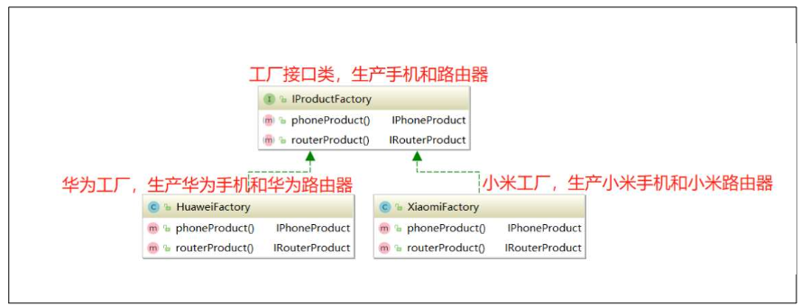
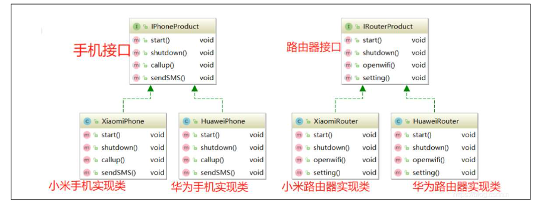

# 设计模式

## 面向对象设计原则

单一职责原则（SRP），就一个类而言，应该仅有一个引起它变化的原因。即在未来只会因为一个原因而去修改这个类，这包括了一些存储方式的变化，新属性的增加等等。这种限制就要求一个类只实现一个职责。

开闭原则（OCP），一个软件实体应当对扩展开放，对修改关闭。即一个模块可以在不被修改的前提下被扩展。比如设置抽象类或者接口，在扩展功能时不需要修改原抽象类或者接口或者他们的子类，只需要创建新的子类。

依赖倒转原则（DIP），高层模块不依赖底层模块，他们都应该依赖抽象，要针对接口编程而不是实现编程。比如在变量类型声明，参数类型声明，方法返还类型声明时，要将其在接口和抽象类中实现，然后让具体类继承这个接口或抽象类，而不是在每个具体的类中进行声明。

## 单例模式

单例模式用啦保证一个类只有一个实例，并提供一个访问它的全局访问点。具体实现方式最好的办法时让类自身负责保存它的唯一实例，这个类可以保证没有其他的实例被创建，同时提供一个访问该实例的方法。

饿汉式做法

```
public class Singleton{
  private static Singleton singleton = new Singleton();
  private Singleton(){}  //构造方法，私有处理使得外部无法通过new直接创建
  public static Singleton GetInstance(){
    return singleton;
  }
}
```

懒汉式做法

```
public class Singleton{
  private static Singleton instance;
  private Singleton(){}
  public static Singleton getInstance(){
    if(instance == null){
      instance = new Singleton();
    }
    return instance;
  }
}
```

同步锁，通过添加synchronized关键字，使得每个线程在进入这个方法前，都要等别的线程离开该方法，即不会允许两个线程同时进入这个方法。

```
public class Singleton{
  private static Singleton instance;
  private Singleton(){}
  public static synchronized Singleton getinstance(){
    if(instance == null){
      instance = new Singleton();
    }
    return instance;
  }
}
```

单例模式有时可以通过反射来破坏。通过反射中的`setAccessible(true)`覆盖Java的访问控制，进而调用私有的构造函数，用getInstance方法调用构造函数。

为了抵御这种破坏，可以在构造方法中判断当前是否有了单例，如果没有再创建，这样可以一定程度抵御反射破坏。

```
public class Singleton{
  private static Singleton singleton = new Singleton();
  private Singleton(){
    if(singleton != null) {
      throw new RuntimeException(“单例构造器禁止通过反射调用");
    }
  }
  public static Singleton GetInstance(){
    return singleton;
  }
}
```

## 工厂模式

简单工厂模式，通过一个工厂类来创建披萨对象，这样在实现更复杂功能时，可以在对应复杂类中使用工厂类来创建披萨对象。但是这并不是一个设计模式，因为其并没有满足开闭原则，即若要新建一个新的披萨类别，需要对这个工厂类进行修改。

```
public class SimplePizzaFactory{
  public Pizza createPizza(String type){
    Pizza pizza = null;
    if(type.equels("cheese")){
      pizza = new CheesePizza();
    }else if(type.equels("greek")){
      pizza = new GreekPizza();
    }...
    return pizza;
  }
}

public class PizzaStore{
  SimplePizzaFactory factory;
  public PizzaStore(SimplePizzaFactory factory){
    this.factory = factory;
  }
  public Pizza orderPizza(String type){
    Pizza pizza;
    pizza = factory.createPizza(type);

    pizza.prepare();
    pizza.bake();
    pizza.cut();
    return pizza;
  }
}
```

工厂模式，将对象的创建封装在类中，先定义一个抽象工厂方法，即只设置返回的产品对象，供父类中的函数使用，而工厂方法的真正实现依赖于子类中的对象创建方法。这种工厂模式可以将一个产品的自身属性和创建解耦合，即创建者类继承于一个抽象类，而产品本身继承于另一个类。

```
public abstract class PizzaStore{
  abstract Pizza createPizza(String type);  //抽象方法
  
  public Pizza orderPizza(String type){
    Pizza pizza;
    pizza = createPizza(type);

    pizza.prepare();
    pizza.bake();
    pizza.cut();
    return pizza;
  }
}

public class NYPizzaStore extends PizzaStore{
  @Override
  public Pizza createPizza(String type){
    Pizza pizza = null;
    if(type.equels("cheese")){
      pizza = new CheesePizza();
    }else if(type.equels("greek")){
      pizza = new GreekPizza();
    }...
    return pizza;
  }
}
```

抽象工厂模式，围绕一个超级工厂创建其他工厂，这种创建型模式在新增一个产品族，即新增一个工厂来生产时，只需要在工厂接口中新建子类，在产品接口中分别新建对应工厂的子类即可，满足OCP原则。但是当拓展一个产品时，除了需要定义新产品接口和对应工厂的产品类，还需要将这个产品继承到工厂接口和工厂类之中，非常麻烦。抽象工厂模式与工厂模式的本质区别在于，抽象工厂模式可以生产多种产品，而工厂模式往往只有一条工作线。





## 策略模式

在有多种算法相似的情况下，使用多个if-else会使得代码变得复杂，策略模式可以允许策略随着对象改变而改变。这个想法本质是将算法和对象分开，进而使得算法可以独立于对象变化。

策略模式设计到三个角色：
环境Context，持有一个Strategy的引用；
抽象策略Strategy，一个抽象角色，通过接口或抽象类实现，给出所有具体策略类所需要的接口；
具体策略ConcreteStrategy，包装了相关算法或行为。

```
public interface MemberStrategy{
  public double calcPrice(double booksPrice);
}

public class PrimaryMemberStrategy implements MemberStrategy{
  @Override
  public double calcPrice(double bookPrice){
    System.out.println("初级会员无折扣")；
    return booksPrice;
  }
}

public class IntermediateMemberStrategy implements MemberStrategy{
  @Override
  public double calcPrice(double bookPrice){
    System.out.println("中级会员折扣10%")；
    return booksPrice * 0.9;
  }
}

public class AdvancedMemberStrategy implements MemberStrategy{
  @Override
  public double calcPrice(double bookPrice){
    System.out.println(高级会员折扣20%")；
    return booksPrice * 0.8;
  }
}

public class Price{
  private MemberStrategy strategy;
  public Price(MemberStrategy strategy){
    this.strategy = strategy;
  }
  public double quote(double booksPrice){
    return this.strategy.calcPrice(booksPrice);
  }
}

public class Client{
  public static void main(String{} args){
    MemberStrategy strategy = new AdvancedMemberStrategy();
    Price price = new Price(strategy);
    double quote = price.quote(300);
    System.out.println("价格为" + quote);
  }
}
```

在策略模式中，各算法是相互平等的，这也是各个算法之间可以相互替换的原因，同时这要求各个算法之间不能相互依赖。

## 迭代器模式

在客户访问类和聚合类（比如集合）之间插入迭代器，分离了聚合对象与其遍历行为。

Java中的迭代器Iterator不是一个集合，是一种访问集合的方法，可以通过迭代访问List和Set等集合，Iterator是Java迭代器最简单实现，ListIterator是Collection API的接口，进一步扩展了Iterator接口。通过`import java.util.Iterator;`引入，并通过`Iterator<String>it = sites.iterator();`初始化，这里的sites对应各种集合。

迭代器it的基本操作是next、hasNext和remove。`it.next()`会返回迭代器的下一个元素并更新迭代器状态；`it.hasNext()`用于检测集合中是否还有元素；`it.remove()`将迭代器返回的元素从迭代器中删除。

循环迭代最简单方式：

`while(it.hasNext()){System.out.println(it.next());}`

## 数据访问对象模式

数据访问对象模式（DAO模式）用于把低级的数据访问操作从高级的业务服务中分离出来。参与的三个角色为：
数据访问对象接口，定义了在一个模型对象上要执行的标准操作；
数据访问对象实体类，实现了上述接口，负责从数据源获取数据，数据源可以是数据库或者xml等等；
模型对象/数值对象，改对象是简单的普通对象，包含get/set方法来存储通过使用DAO类检索到的数据。

数据访问对象模式，由于新增了DAO层，数据层与服务层隔离开了，同时不必与特定的读取和写入数据库的实现方式进行绑定。

```
public class Student{
  private String name;
  private int rollNo;
  Student(String name,int rollNo){
    this.name = name;
    this.rollNo = rollNo;
  }
  public String getName(){
    return name;
  }
  public void setName(String name){
    this.name = name;
  }
  public int getRollNo(){
    return rollNo;
  }
  public void setRollNo(int rollNo){
    this.rollNo = rollNo;
  }
}

public interface StudentDao{
  List<Student> getAllStudents();
  Student getStudent(int rollNo);
  void updateStudent(Student student);
  void deleteStudent(Student student);
}

public class StudentDaoImpl implements StudentDao{
  List<Student> students;
  public StudentDaoImpl(){
    students = new ArrayList<Student>();
    Student student1 = new Student("Alice",0);
    Student student2 = new Student("Bob",1);
    student.add(student1);
    student.add(student2);
  }
  @Override
  public void deleteStudent(Student student){
    student.remove(student.getRollNo());
  }
  @Override
  public List<Student> getAllStudents(){
    return students;
  }
  @Override
  public Student getStudent(int rollNo){
    return students.get(rollNo);
  }
  @Override
  public void updateStudent(Student student){
    students.get(student.getRollNo()).setName(student.getName());
  }
}

public class DataAccessObjectPatternDemo{
  public calss main(String[] args){
    StudentDao studentdao = new StudentDaoImpl();
    for(Student student : studentdao.getAllStudents()){
      System.out.println(student.getName() + "No." + student.getRollNo())
    }
    Student student = studentdao.getAllStudents().get(0);
    student.setName("Charlie");
    studentdao.updateStudent(student);
  }
}
```

## 生产者消费者设计模式

在软件开发过程中，会碰到某个模块负责产生数据，这些数据由另一个模块来负责处理的场景，产生数据的模块被称为生产者，处理数据的，模块被称为消费者。在生产者和消费者之间存在内存缓冲区，如果消费者消费的慢，生产者生成的快，那缓冲区达到最大后就会阻塞生产者；同样当消费者消费的快，生产者生成的慢，那缓冲区空了后就会阻塞消费者。

如何保证缓存区数据状态一致，以及消费者和生产者同步协作就非常重要，一般通过加同步锁或利用线程内部通信来完成。

```
import java.util.ArrayList;
import java.util.List;
import java.util.Random;

/**
 * 缓冲区类（Buffer）
 * 作为生产者和消费者共享的中间容器
 */
class Buffer {
    // 1. 数据存储容器
    private List<Integer> data = new ArrayList<>();

    // 2. 定义缓冲区的容量上限和下限
    private static final int MAX = 2; // 缓冲区最多容纳2个数据
    private static final int MIN = 0; // 缓冲区最少为0个数据（空）

    /**
     * 生产者调用的放入数据方法
     * @param value 需要放入的数据
     */
    public void put(int value) {
        // 生产者可以无限循环不断地生产数据
        while (true) {
            try {
                // 模拟生产者花费500ms生成数据的过程
                Thread.sleep(500);
            } catch (InterruptedException e) {
                e.printStackTrace();
            }

            // 3. 使用 synchronized 锁住当前 Buffer 对象，保证线程安全
            synchronized (this) {
                // 4. 核心逻辑：检查缓冲区是否已满
                while (data.size() == MAX) {
                    System.out.println("buffer is full, waiting ....");
                    try {
                        // 如果已满，当前生产者线程在 this (Buffer对象) 上等待
                        // 释放锁，并进入等待状态，等待消费者取出数据后唤醒它
                        wait();
                    } catch (InterruptedException e) {
                        e.printStackTrace();
                    }
                }
  
                // 5. 如果没有满，继续生产
                System.out.println("producer--" + Thread.currentThread().getName() + "--put:" + value);
                // 将数据添加到缓冲区
                data.add(value);
  
                // 6. 唤醒所有在 this 对象上等待的线程（包括其他的消费者和生产者）
                // 通知大家：我刚刚放了新数据，你可以来取了；或者缓冲区有空间了，你可以来放了
                notifyAll();
            }
        }
    }

    /**
     * 消费者调用的取出数据方法
     * @return 取出的整数数据
     */
    public Integer take() {
        Integer val = 0;
        // 消费者也可以无限循环不断地消费数据
        while (true) {
            try {
                // 模拟消费者花费500ms处理数据的过程
                Thread.sleep(500);
            } catch (InterruptedException e) {
                e.printStackTrace();
            }

            // 7. 同样需要获取 this (Buffer对象) 的锁
            synchronized (this) {
                // 8. 核心逻辑：检查缓冲区是否为空
                while (data.size() == MIN) {
                    System.out.println("buffer is empty, waiting ...");
                    try {
                        // 如果为空，当前消费者线程在 this 上等待
                        // 释放锁，进入等待状态，等待生产者放入数据后唤醒它
                        wait();
                    } catch (InterruptedException e) {
                        e.printStackTrace();
                    }
                }
  
                // 9. 如果有数据，继续消费
                // 取出列表中的第一个数据（FIFO 先进先出）
                val = data.remove(0);
                System.out.println("consumer--" + Thread.currentThread().getName() + "--take:" + val);
  
                // 10. 取出数据后，通知所有等待中的线程
                // 通知大家：我刚刚取出了数据，缓冲区有空间了，生产者你可以继续放了
                notifyAll();
            }
        }
    }
}

/**
 * 生产者线程实现类
 */
class Producer implements Runnable {
    // 持有 Buffer 对象的引用，通过构造函数传入
    private Buffer buffer;

    public Producer(Buffer buffer) {
        this.buffer = buffer;
    }

    @Override
    public void run() {
        // 每次执行时，生成一个 0-99 之间的随机数，放入缓冲区
        buffer.put(new Random().nextInt(100));
    }
}

/**
 * 消费者线程实现类
 */
class Consumer implements Runnable {
    // 持有 Buffer 对象的引用，通过构造函数传入
    private Buffer buffer;

    public Consumer(Buffer buffer) {
        this.buffer = buffer;
    }

    @Override
    public void run() {
        // 每次执行时，从缓冲区中取出一个数据
        Integer val = buffer.take();
    }
}
```

## 模板方法模式

定义一个操作中的算法股价，将其中一些步骤延伸到子类中，模范方法模式使得子类可以不改变一个算法的结构即可重新定义该算法的某些特定步骤。

由一个AbstractClass抽象类给出抽象模板，定义并实现一个模板方法，并给出顶层逻辑的骨架；另一个ConcreteClass具体类实现父类定义的一个或多个抽象方法，一个抽象类可以由多个具体子类，每一个抽象类都可以给出抽象方法的不同实现。

```
public abstract class AbstractClass
{
    public abstract void PrimitiveOperation1();
    public abstract void PrimitiveOperation2();
    public void TemplateMethod()
    {
        PrimitiveOperation1();
        PrimitiveOperation2();
        System.out.println("");
    }
}
public class ConcreteClassA extends AbstractClass
{
    public void PrimitiveOperation1()
    {
        System.out.println("具体类A方法1实现");
    }
    public void PrimitiveOperation2()
    {
        System.out.println("具体类A方法2实现");
    }
}
public class ConcreteClassB extends AbstractClass
{
    public void PrimitiveOperation1()
    {
        System.out.println("具体类B方法1实现");
    }
    public void PrimitiveOperation2()
    {
        System.out.println("具体类B方法2实现");
    }
}
```

这种模式下，把不变的行为搬到了超类，去除了子类中的重复代码，提高了代码复用。

同时在这个模式下允许并且提倡抽象类靠具体类实现算法的具体细节，即在抽象类中定义出整套流程，但其中具体实现交给具体类去做。这会出现类似父类调用子类方法的操作，称为反向控制系统。

## 观察者模式

又称MVC模式。当一个对象的状态或行为的变化导致其他对象的状态或行为产生变化，观察者模式定义了对象之间一种一对多的依赖关系，让一个对象的改变能够影响其他对象。发生改变的对象称为观察目标，被通知的对象称为观察者，一个观察目标可以对应多个观察者。

观察者模式定义了对小黏糕之间的一种一对多关系，使得每当一个对象状态发生改变后，其相关依赖对象都得到通知并自动更新。

```
public abstract class MySubject {
    protected ArrayList observers = new ArrayList();

    // 注册方法
    public void attach(MyObserver observer) {
        observers.add(observer);
    }

    // 注销方法
    public void detach(MyObserver observer) {
        observers.remove(observer);
    }

    public abstract void cry();  // 抽象通知方法
}
public class Cat extends MySubject {
    public void cry() {
        System.out.println("猫叫！");
        System.out.println("--------");

        for (Object obs : observers) {
            ((MyObserver) obs).response();
        }
    }
}
public interface MyObserver {
    void response();  // 抽象响应方法
}
public class Dog implements MyObserver {
    public void response() {
        System.out.println("狗跟着叫！");
    }
}

public class Mouse implements MyObserver {
    public void response() {
        System.out.println("老鼠努力逃跑！");
    }
}
public class Client {
    public static void main(String[] args) {
        MySubject subject = new Cat();

        MyObserver obs1, obs2, obs3;
        obs1 = new Mouse();
        obs2 = new Mouse();
        obs3 = new Dog();

        subject.attach(obs1);
        subject.attach(obs2);
        subject.attach(obs3);

        subject.cry();
    }
}
```

观察者模式实现了表示层和数据逻辑层的分离，在观察目标和观察者之间建立了一个抽象的耦合，支持广播通信，符合开闭原则。
