# 集合

java的java.util包中提供集合类，集合类与数组区别是，数组长度固定，可以存放基本类型数据；集合长度可变，只能存放对象的引用。

最基本接口是Collection接口，定义了操作数据的基本方法，常用集合由List集合、Set集合、Map集合，List和Set实现了Collection接口。Collection集合存储元素集合，Map集合存储键值对映射。

## List接口

List接口定义了一个有序的对象集合，允许重复元素存在。List类似于动态数组或者变长数组，List中存放的元素的数量可以随着插入操作自动调整。

### ArrayList

ArrayList类是一个可以动态修改的数组。与普通数组的区别就是它没有固定大小的限制，可以添加或删除元素。ArrayList继承AbstractList类，实现了List接口。类提供了相关的添加删除修改遍历等功能。

通过`import java.util.ArrayList;`引入，通过`ArrayList<E> objectName = new ArrayList<E>();`初始化，其中E指数据类型，只能用引用数据类型。objectName即这个对象的名字，后续用sites来指代。

`sites.add("abc");`通过调用add方法增加元素，默认会在列表尾部添加元素。

`sites.add(1,"abc");`通过在add方法中添加index，可以实现在列表中间添加元素，会将添加的元素放到对应索引处，将该索引以及之后索引对应的元素整体后移一位。

`sites.get(1);`通过调用get方法，调取对应index处的元素。

`sites.set(1,"bcd");`通过调用set方法，将对应index处的元素改成新的元素。

`sites.remove(3);`通过调用remove方法，将对应index处的元素删除。

`sites.size();`通过调用size方法，计算列表中的元素个数。

`for(int i=0;i<sites.size();i++)` 或`for(String i : sites)`的方式来迭代元素。

### LinkedList

链表类似于ArrayList，LinkedList在元素的增加和删除操作上操作效率更高，但是查找和修改的操作效率较低。所以当只需要在末尾增删元素的时候用ArrayList更好，需要在各个位置增删元素的时候用LinkedList更好。

LinkedList实现了队列、栈等的接口，可以通过在初始化时声明一个对应接口的变量，接着将其赋值为LinkedList类的对象，将这个变量变成纯正的接口实现的类型。

通过`import java.util.LinkedList;`引入，通过`LinkedList<E> objectName = new LinkedList<E>();`初始化，其中E指数据类型，只能用引用数据类型。objectName即这个对象的名字，后续用list来指代。比如要声明一个队列，就可以用`Queue<String> queue = new LinkedList<String>();`

`list.add("abc");`通过调用add方法增加元素，默认会在列表尾部添加元素。

`list.addLast("abc");`通过调用addLast方法在链表结尾增加元素。

`list.addFirst("abc");`通过调用addFirst方法在链表开头增加元素。

`list.add(1,"abc");`通过在add方法中添加index，可以实现在列表中间添加元素，会将添加的元素放到对应索引处，将该索引以及之后索引对应的元素整体后移一位。（由于在查找时，链表花的时间比列表时间长，所以并不是链表的增删元素一定更快，但一般还是用链表）

`list.removeFirst();list.removeLast();`通过调用removeFirst和removeLast方法，删除开头和结尾处的元素。

`for(int i=0;i<list.size();i++)` 或`for(String i : list)`的方式来迭代元素。

## Set集合

Set集合中的对象不按特定方式排序，只是将对象加入集合，但是Set集合中不能包含重复对象。Set集合由Set接口和Set接口的实现类组成，Set接口继承Collection接口，包含Collection接口的所有方法。常用的Set是HashSet。

HashSet是基于HashMap实现的，不允许有重复元素，允许有null值，不会记录插入的顺序，不是线程安全的（对于多线程同时修改HashSet会产生不确定结果），实现了Set接口。

通过`import java.util.HashSet;`引入，通过`HashSet<E> objectName = new HashSet<E>();`初始化，其中E指数据类型，只能用引用数据类型。objectName即这个对象的名字，后续用sites来指代。

`sites.add("abc");`通过调用add方法增加元素。

`sites.contains("abc");`通过调用contains方法来判断元素是否存在于集合中。

`sites.remove("abc");`通过调用remove方法，将对应的元素删除。`sites.clear()`可以调用clear方法删除集合中所有元素。

`sites.size();`通过调用size方法，计算集合中的元素个数。

`for(int i=0;i<sites.size();i++)` 或`for(String i : sites)`的方式来迭代元素。

## Map集合

Map接口提供将key映射到值的对象，一个映射不能包含重复的key，每个key最多只能映射到一个值。对于一个Map有这样的基本方法：

`put(K key,V value)`向集合中添加指定的key，value映射关系。

`containsKey(Object key)`如果映射中包含有key的映射关系则返回true。

`containsValue(Object value)`如果映射中将一个或多个key映射到指定value则返回true。

`get(Object key)`如果存在key，则返回对应的value，否则null。

`keySet()`返回所有key形成的Set集合。

`values()`返回所有value形成的Collection集合。

一般常用的Map是HashMap，HashMap是个散列表，存储键值对的映射，其实现了Map接口，根据键的HashCode存储数据，访问速度很快。HashMap的键值类型可以相同也可以不同。

通过`import java.util.HashMap;`引入，通过`HashMap<K,V> objectName = new HashMap<K,V>();`初始化，其中K,V指键和值数据类型，只能用引用数据类型。objectName即这个对象的名字，后续用sites来指代。

`sites.put(1,"abc");`通过调用put添加键值对。

`sites.get(1);`通过调用get方法，调取key对应的value。

`sites.remove(1);`通过调用remove方法，将key对应的键值对删除。`sites.clear()`可以删除集合中所有元素。

`sites.size();`通过调用size方法，计算map中的键值对个数。

`for(Integer i : sites.keySet())` `for(String i : sites.values())`的方式来迭代元素。

# 流与输入输出

流是一组有序的数据序列，将数据从一个地方带到另一个地方。在Java中，对于数据的输入输出操作都是流的方式进行，各个设备可以是文件、网络、内存等等。

流具有方向性，输入流和输出流是个相对概念，一般以程序作为参考，即从程序流向设备是输出流，从设备流向程序是输入流。同时，流还可以按照数据单位不同分成字节流（基本单位是字节8bit）和字符流（基本单位是字符16bit），按照数据封装类型分为节点流（可以从或向一个特定地方读写数据，比如FileReader）和处理流（用来包装节点流，对一个已知流进行封装，比如BufferedReader的输入参数是一个其他流的对象）。

Java的流家族位于java.io包中，分别继承下面的四种抽象流类型：


|        | 字节流       | 字符流 |
| ------ | ------------ | ------ |
| 输入流 | InputStream  | Reader |
| 输出流 | OutputStream | Writer |

FileInputStream流用于从文件读取数据`InputStream f = new FileInputStream("C:/java/hello");`也可以创建一个File对象`File f = new File("C:/java/hello"); InputStream in = new FileInputStream(f);`

FileOutputStream用于创建一个文件并向其中写数据`OutputStream f = new FileOutputStream("C:/java/hello");`也可以创建一个File对象`File f = new File("C:/java/hello"); OutputStream fOut = new FileOutputStream(f);`

对于Unicode文本，可以用抽象类Reader和Writer的子类，是基于字符的。

BufferedReader用来提高效率，例如包装InputStreamReader，`BufferedReader in = new BufferedReader(new InputStreamReader(System.in));`

InputStreamReader/OutputStreamReader，可包装InputStream，将基于字节的输入流转换为基于字符的Reader，用于从文件中读取字符。`InputStream inputStream = new FileInputStream("D:\\test\\1.txt"); Reader inputStreamReader = new InputStreamReader(inputStream);`

与控制台System.in结合可以做到`BufferedReader br = new BufferedReader(new InputStreamReader(System.in));`

## 操作文件

Path和Files类封装了处理文件所需要的所有功能。

Path表示的是一个目录名序列，后边可以跟着一个文件名。`Path absolute = Paths.get("c:\data\myfile.txt");Path relative = Paths.get("myfile.txt");`这里`Paths.get`方法接受一个或多个字符串，并将他们用默认文件系统的路径分隔符(UNIX`/` Windows`\\`)连接。

Files是操作文件的工具类，可以用Files提供的读写方法直接读写小文件，不过对于大型文件还是需要文件流处理。

读文件，可以直接读取字节，也可以将其转换为string，同样可以将其以行序列方式读入。

`byte[] bytes = Files.readAllBytes(path);` `String content = Files.readString(path,charset); //charset指字符集，默认UTF-8` `List<String> lines = Files.readAlllines(path,charset);`

写文件，将一个字符串写到文件，追加内容使用write，也可以将一个行的集合写出到文件

`Files.writeString(path,content,charset)` `Files.write(path,content,charset);` `Files.write(path,lines,charset)`

创建文件和目录，赋值移动删除文件

`Files.creatDirectory(path);`路径中除了最后一个部件其余的都要真实存在，这个方法只能创建最后的那一个目录。

`File.createFile(path);`如果文件已经存在则会报错。

`Files.copy(fromPath,toPath);`复制文件

`Files.move(fromPath,toPath);`移动文件，如果目标路径已经存在，那么复制或者移动就会失败，想要覆盖已有目标路径可以使用REPLACE_EXISTING选项，如果想要复制所有的文件属性，可以使用COPY_ATTRIBUTES选项，当然这两个选项可以同时使用`Files.copy(fromPath,toPath,standardCopyOption.REPLACE_EXISTING,standardCopyOption.COPY_ATTRIBUTES);`可以将移动操作定义为原子性操作，这样可以保证要么移动操作成功完成，要么源文件保持在原来位置，可以用AIOMC_MOVE实现，即`Files.move(fromPath,toPath,standardCopyOption.ATOMIC_MOVE);`。

`Files.delete(path);`用来删除文件，若删除文件不存在，会抛出异常，可以使用下面的方法来解决，同时该方法还可以永安里移除空目录。`boolean deleted = Files.deleteIfExists(path);`

还可以通过一些方法获得文件的属性信息:`exists()` `isHidden()` `isReadable()` `isWritable()` `isExecutate()` `isRegularFile()` `isDirectory()` `isSymbolicLink()` `Size()`

## 对象输入输出与序列化

Java支持对象序列化的机制，可以将对象写出到输出流中，并在之后将其读回。把对象转换为字节序列的过程称为对象的序列化，把字节序列恢复为对象的过程称为对象的反序列化。通过对象序列化，可以将对象的字节序列永久保存在硬盘上，比如一些文件中；同时在网络传送对象时，由于网络只接受二进制序列的形式，因此需要将对象转换为字节序列才能在网络上传送，接收方再将其反序列化得到对象。但是被static修饰的字段是没有办法进行序列化和反序列化的，static修饰的属于类中的属性，是对象共有的，在序列化对象时不会将这个属性序列化，在反序列化出的对象可以直接使用类中的static字段。

Java.io.ObjectOutputStream代表对象输出流，它的writeObject(Object obj)方法可以对obj对象进行序列化，把得到的字节序列写到目标输出流中。通过`ObjectOutputStream(OutputStream out)`的方式创建ObjectOutputStream，通过`writeObject(Object obj)`写出指定对象到ObjectOutputStream。

Java.io.ObjectInputStream代表对象输入流，它的readObject()方法可以从一个源输入流中读取字节序列，并将其反序列化为一个对象返回。通过`ObjectInputStream(InputStream in)`创建一个ObjectInputStream，通过`Object readObject()`从ObjectInputStream中读入一个对象。

```
public class Person implements Serializable {
  private String name;
  private int age;
  public Person(String name, int age) {
    this.name = name;
    this.age = age;
  }
  //为了方便查看对象，重写默认的toString()
  @Override
  public String toString(){
    return "Person{" + "name='" + name + '\'' + ", age=" + age +'}';
  }
}
```

```
public class SeriDemo {
  public static void main(String[] args) {
    // ObjectOutputStream流
    try {
      Person p1 = new Person(“zhangsan”, 30);
      System.out.println(p1);
      ObjectOutputStream oos = new ObjectOutputStream(new FileOutputStream(“person.dat”));
      oos.writeObject(p1); //序列化
    } catch (Exception e) {
      e.printStackTrace();
    }
  }
}
```

```
//创建一个ObjectInputStream输入流
try (ObjectInputStream ois = new ObjectInputStream(new FileInputStream(“person.dat”))){
  System.out.println(“readObject()：”);
  Person zhangsan = (Person) ois.readObject();// 反序列化
  System.out.println(zhangsan);
} catch (Exception e) {
  e.printStackTrace();
}
```

# Swing图形页面

## MVC模式

每个组件对象都有三个特征，即内容、外观、行为，为了实现这些需求，Swing采用了MVC模式，分成了模型、视图、控制器。

模型(Model)存储完整的内容，实现改变内容和查找内容的方法，无用户界面。
视图(View)可以有多个，每个视图可以显示全部内容的不同部分，当模型更新时需要更新所有与之关联的视图。
控制器(Controller)将视图与模型分开，负责处理用户输入事件，并决定是否将事件转化成对模型或视图的更改。
比如，用户在文本框上敲下一个按键，控制器调用模型的插入字符命令，然后模型钙塑视图进行更新。

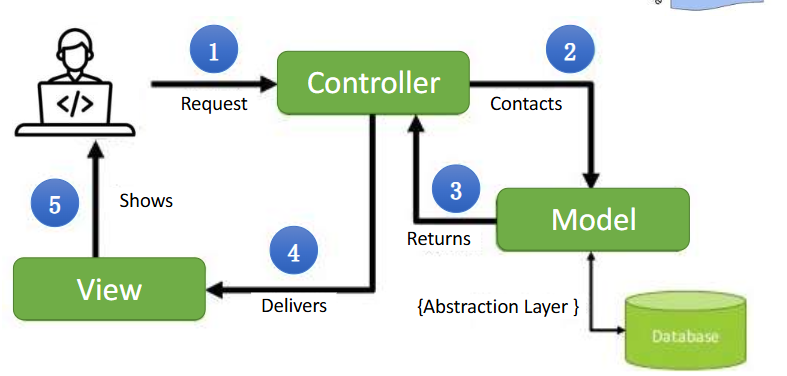

## Swing

Swing是用于JavaGUI编程的工具包，采用纯Java实现。Swing组件都采用MVC设计，实现GUI显示逻辑和数据逻辑的分离，可以自定义Render来改变GUI组件的外观。

SwingGUI包含了两种元素，分别是容器和组件。一个容器可以容纳一组组件，且容器本身也是组件，容器也可以放到别的容器中。组件时单独的控制元素，例如按键或者文本编辑框，组件只有放到容器中才会显示。

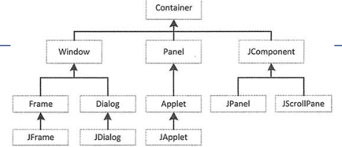

Swing的组件继承于JComponent类，常见组件有标签JLabel，按键JButton，输入框JTextField，复选框JCheckBox，列表JList

Swing的容器分为重量级容器（顶层容器），不继承JComponent，包括JFrame，JApplet，JDialog，这些容器无法被其他容器包含，只能作为界面程序的最顶层容器还包含其他组件。
第二类容器是轻量级容器，它们继承于JComponent，包括JPanel，JScrollPanel等等，可以将多个相关联组件放一起，这些容器可以被其他容器包含。

在向容器中添加组件时，需要考虑组件的位置和大小，布局管理器控制着容器中组件的位置，需要给容器设置一种布局管理器，这个布局管理器可以管理容器中各个组件的位置。

布局管理器有FlowLayout（流式管理器，从左到右中间放置，一行放不下就换另外一行）、BorderLayout（边框布局管理器，分东西南北中五个方位）、GridLayout（网格式布局）、GridBagLayout（网格式布局，可以防止不同大小组件）、BoxLayout（盒布局管理，把组件水平或者竖直排一起）、SpringLayout（按照一定约束条件组织）等等

```
JFrame frame=new JFrame("Java GUI程序"); //创建Frame窗口
frame.setSize(400,200);
frame.setLayout(new BorderLayout()); //为Frame窗口设置布局为BorderLayout
JButton button1=new JButton ("上");
JButton button2=new JButton("左");
JButton button3=new JButton("中");
JButton button4=new JButton("右");
JButton button5=new JButton("下");
frame.add(button1,BorderLayout.NORTH);
frame.add(button2,BorderLayout.WEST);
frame.add(button3,BorderLayout.CENTER);
frame.add(button4,BorderLayout.EAST);
frame.add(button5,BorderLayout.SOUTH);
frame.setBounds(300,200,600,300);
frame.setVisible(true);
frame.setDefaultCloseOperation(JFrame.EXIT_ON_CLOSE);
```

顶层窗口称为窗体（Frame），是JFrame类，我们只需要关注内容窗格。

所有的Swing组件必须由事件分派线程配置，这是控制线程，将鼠标点击和按键等事件传递给用户接口组件，通过`frame.setDefaultCloseOperation(JFrame.EXIT_ON_CLOSE)`

```
public static void main(String[] args) {
    // 使用 EventQueue.invokeLater 把创建界面的任务“打包”
    // 交给 EDT 线程去排队执行
    EventQueue.invokeLater(() -> {
        // 这里的代码，才是真正由 EDT 线程执行的！
        JFrame frame = new JFrame("我的窗口");
        frame.setVisible(true); 
    });
}
```

组件绘制，扩展JComponent，覆盖其中的paintComponent方法，设置Graphics对象。这里Graphics对象可以想成画笔，是作图的基础，但是其用法在JComponent中以及写好了，实际使用时不需要处理，只需要在窗口中add这个组件即可。

```
class helloworldComponent extends JComponent{
  private static final int MSG_X = 75;
  private static final int MSG_Y = 100;
  private static final int DEFAULT_WIDTH = 300;
  private static final int DEFAULT_HEIGHT = 200;

  public void paintComponent(Graphics g){
    g.drawString("Hello World",MSG_X,MSG_Y);
  }

  public Dimension getPreferredSize(){
    return new Dimension(DEFAULT_WIDTH,DEFAULT_HEIGHT);
  }
}
class helloworldFrame extends JFrame{
  public helloworldFrame(){
    add(new helloworldComponent());
    pack();    //这里用pack方法来使用组件的首选大小，即PreferredSize
  }
}
```

也可以通过一些Java2D库绘制图形

```
class DrawComponent extends JComponent {
    public static final int DEFAULT_WIDTH = 400;
    public static final int DEFAULT_HEIGHT = 400;

    public void paintComponent(Graphics g) {
        var g2 = (Graphics2D) g;

        double leftX = 100;
        double topY = 100;
        double width = 200;
        double height = 150;

        var rect = new Rectangle2D.Double(leftX, topY, width, height);
        g2.setPaint(Color.RED);    //设置颜色
        //也可以用new Color(147,112,219)的方式通过三色分量创建Color对象
        g2.draw(rect);
    }

    public Dimension getPreferredSize() {
        return new Dimension(DEFAULT_WIDTH, DEFAULT_HEIGHT);
    }
}
```

可以通过ImageIcon类从文件获取图像，进而显示图像

```
public void paintComponent(Graphics g){
  int X = 100;
  int Y = 100;
  Image image = new ImageIcon(path).getImage();

  g.drawImage(iamge,X,Y,null);
}
```

## 事件机制

改变对象的状态被称为事件，比如点击按钮，输入字符等等。在事件机制中有三类关键对象，分别是事件（Event，一次操作），事件源（EventSource，事件发生的场所，通常就是各个组件），事件监听器（实现了监听器接口的类实例）。

```
class MyListener implements ActionListener{
  public void actionPerformed(ActionEvent event)
  {
    //reaction to button click goes here
  }
}
```

用户点击按钮时，Jbotton对象就会创建一个ActionEvent对象，然后调用listener.actionPerformed(event)，并传入这个事件对象，这里的listener即使用的监听器接口。一个事件源理论上可以有多个监听器，进而可以监听不同种类的事件。

```
public class ListenerTest extends JFrame {

    // 窗口默认尺寸常量
    public static final int DEFAULT_WIDTH = 300;
    public static final int DEFAULT_HEIGHT = 200;
  
    // 按钮容器面板
    private JPanel buttonPanel;

    public ListenerTest() {
        // 1. 设置窗口基本信息
        setTitle("ListenerTest");
        setSize(DEFAULT_WIDTH, DEFAULT_HEIGHT);
        setDefaultCloseOperation(JFrame.EXIT_ON_CLOSE);

        // 2. 创建按钮面板并添加到窗口
        buttonPanel = new JPanel();
        add(buttonPanel);

        // 3. 调用辅助方法生成颜色按钮
        makeButton("yellow", Color.YELLOW);
        makeButton("blue", Color.BLUE);
        makeButton("red", Color.RED);
        makeButton("green", Color.GREEN);
    }

    public void makeButton(String name, Color backgroundColor) {
        // 创建按钮并添加到面板
        JButton button = new JButton(name);
        buttonPanel.add(button);

        // 使用 Lambda 表达式添加监听器（点击按钮改变背景色）
        button.addActionListener(event -> 
            buttonPanel.setBackground(backgroundColor)
        );
    }

    public static void main(String[] args) {
        // 使用事件分派线程（EDT）创建并显示界面
        EventQueue.invokeLater(() -> {
            ListenerTest frame = new ListenerTest();
            frame.setVisible(true); // 窗口显示为可见
        });
    }
}
```

## 基本组件

文本输入有三种方法，分别是文本域（接受单行文本）、文本区（接受多行文本）、密码域（接受单行文版，但不显示文本内容）

标签组件可以容纳文本，本身不能相应用户输入`new JLabel("User name:",SwingConstants.Right)`

可以通过滚动窗格来做滚动条。

`var textArea = new JTextArea(TEXTAREA_ROWS,TEXTAREA_COLUMNS);var scrollPanel = new JScrollPanel(textArea);`

复选框，自动带标签。创建：`bold = new JCheckBox("Bold");`，选择取消选择：`bold.setSelected(true);`，获取复选框状态：`bold.isSelected();`


单选按钮，多个选择只能选一项，构造ButtonGroup类对象，将JRadioButton类型对象添加进组，同时需要为所有单选按钮设定动作命令，在监听器中调取的是每个按钮的动作命令

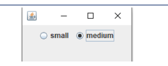

```
public class RadioButtonGroupTest extends JFrame {

    // 窗口默认尺寸常量
    public static final int DEFAULT_WIDTH = 400;
    public static final int DEFAULT_HEIGHT = 200;
  
    // 顶部显示用户当前选择的标签
    private JLabel selectionLabel;
    // 单选按钮组
    private ButtonGroup group;

    public RadioButtonGroupTest() {
        // 1. 设置窗口基本信息
        setTitle("RadioButtonGroup Test");
        setSize(DEFAULT_WIDTH, DEFAULT_HEIGHT);
        setDefaultCloseOperation(JFrame.EXIT_ON_CLOSE);
  
        // 将布局改为垂直排列，方便观察
        setLayout(new BorderLayout());

        // 2. 创建顶部显示标签
        selectionLabel = new JLabel("当前未选择任何选项");
        add(selectionLabel, BorderLayout.NORTH);

        // 3. 创建 ButtonGroup（单选组核心）
        group = new ButtonGroup();
  
        // 创建中间存放单选按钮的面板
        JPanel buttonPanel = new JPanel();
  
        // 4. 依次创建单选按钮并加入按钮组
        // 参数说明：按钮文本, 初始是否选中(false)
        JRadioButton smallButton = new JRadioButton("small", false);
        JRadioButton mediumButton = new JRadioButton("medium", true); // 默认选中 medium
        JRadioButton largeButton = new JRadioButton("large", false);

        smallButton.setActionCommand("small"); //设定动作命令
        mediumButton.setActionCommand("medium"); //设定动作命令
        largeButton.setActionCommand("large"); //设定动作命令
  
        // 将它们加入 buttonGroup 实现互斥
        group.add(smallButton);
        group.add(mediumButton);
        group.add(largeButton);
  
        // 将按钮放入面板（面板负责显示，ButtonGroup 只负责逻辑互斥）
        buttonPanel.add(smallButton);
        buttonPanel.add(mediumButton);
        buttonPanel.add(largeButton);
  
        add(buttonPanel, BorderLayout.CENTER);

        // 5. 绑定事件监听器（对应图片中的监听器逻辑）
        CheckboxListener listener = new CheckboxListener();
        smallButton.addActionListener(listener);
        mediumButton.addActionListener(listener);
        largeButton.addActionListener(listener);
    }

    /**
     * 自定义监听器（完全对应图片中的逻辑）
     */
    class CheckboxListener implements ActionListener {
        public void actionPerformed(ActionEvent ev) {
            // 核心逻辑：通过 ButtonGroup 获取当前选中的按钮，再拿到 ActionCommand
            if (group.getSelection() != null) {
                String choice = group.getSelection().getActionCommand();
                // 将获取到的选择显示在窗口顶部的标签上
                selectionLabel.setText("ACTION Choice Selected: " + choice);
                System.out.println("ACTION Choice Selected: " + choice);
            }
        }
    }

    /**
     * 主方法：启动程序
     */
    public static void main(String[] args) {
        EventQueue.invokeLater(() -> {
            RadioButtonGroupTest frame = new RadioButtonGroupTest();
            frame.setVisible(true);
        });
    }
}
```

组合框，提供一个下拉选择列表。

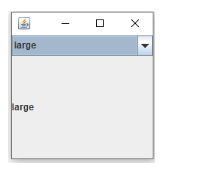

```
JComboBox<String> faceCombo = new JComboBox<>();
faceCombo.addItem("small");
faceCombo.addItem("medium");
faceCombo.addItem("large");
//监听器
faceCombo.addActionListener(event->
label.setText(faceCombo.getSelectedItem().toString()));
//删除选项
faceCombo.removeItem("small");
faceCombo.removeItemAt(0);
```

菜单栏，窗口顶部的菜单栏，包含菜单名字，以及菜单项和子菜单。

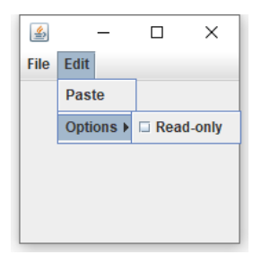

```
var menuBar = new JMenuBar();            // 创建菜单栏
frame.setJMenuBar(menuBar);              // 将菜单栏放在窗体顶部
// 2. 创建顶层菜单
var fileMenu = new JMenu("File");        // 创建 "File" 菜单
menuBar.add(fileMenu);                   // 添加到菜单栏
var editMenu = new JMenu("Edit");        // 创建 "Edit" 菜单
menuBar.add(editMenu);                   // 添加到菜单栏
// 3. 在 "Edit" 菜单中添加功能
var pasteItem = new JMenuItem("Paste");  // 创建普通的菜单项 "Paste"
editMenu.add(pasteItem);                 // 添加到 Edit 菜单
editMenu.addSeparator();                 // 添加一条分隔线
var optionMenu = new JMenu("Options");   // 创建带有子菜单的 "Options" 菜单
var readonlyItem = new JCheckBoxMenuItem("Read-only"); // 创建带复选框的菜单项
optionMenu.add(readonlyItem);            // 将复选框添加到 Options 中
editMenu.add(optionMenu);                // 将 Options 子菜单添加到 Edit 菜单
```

# 多线程

## 进程与线程

进程Process是正在运行的程序的实例，具有私有空间，彼此隔离，每个进程都虚拟拥有整台计算机资源，同时多进程之间不共享内存，在进程之间通过消息传递进行协作。一般来说，进程=程序=应用，但是一个应用中也可能包含多个进程。

线程是进程中一个单一顺序的控制流，这是操作系统能够进行运算调度的最小单位，包含在进程中，是进程的实际运作单位，一个进程可以并发多个线程，一个进程至少包含一个线程，多个线程之间共享内存。

## 线程操作

线程状态有新建状态（New）、可运行状态（Runnable）、阻塞状态（Blocked）、等待状态（Waiting）、计时等待状态（Timed Waiting）、终止状态（Terminated）。

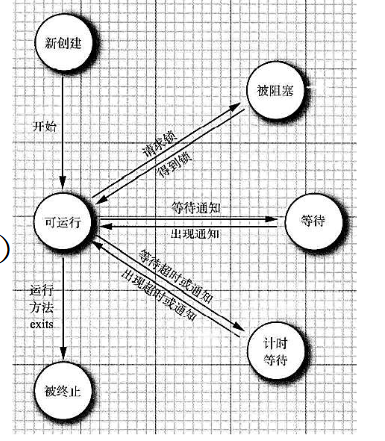

### 创建线程

创建线程可以通过建立Thread类的子类，或者实现Runnable接口来实现。然后可以通过调用start方法启动线程，这将引发调用run方法。

对于通过Thread子类创建的线程，可以直接通过new一个该对象，并调用Thread类中的start方法来启动这个线程`new Thread1().start();`

对于通过实现Runnable接口创建的线程，其本质只是一个有run方法的普通任务类，并没有线程属性，可以将含run方法的实现Runnable接口的对象作为参数传入Thread类初始化过程，进而新建一个有此run方法的Thread类，接着就可以调用Thread类中的start方法来启动这个线程了。`new Thread(new Thread2()).start();`

在实际使用中，Runnable更常用，原因在其任务与运行解耦，更容易实现多线程资源共享，同时避免由于单继承带来的局限性。

### 终止线程

线程会因为run方法正常退出导致自然终止，或者一个没有捕获的异常终止了run方法使得线程意外终止。

stop方法终止线程（这个方法强烈不建议使用），会直接杀死线程，并不会和线程进行互操作，极容易发生数据错误等等等问题。

### 线程阻塞与等待

当一个线程试图获取一个内部的对象锁，而该锁被其他线程持有，这时这个线程就会进入阻塞状态。当所有其他线程释放该锁，且线程调度器允许本线程持有它，该线程就会变成非阻塞状态。

当线程等待另一个线程通知调度器一个条件时，进入等待状态。比如当前线程调用wait方法，这时线程会进入等待状态，等待其他线程对象调用notify或notifyAll方法唤醒该线程。又比如其他线程调用join方法，该线程会等待调用join方法的线程结束后再继续运行。

有几个方法具有一个超时参数，调用这些方法时，会使得线程进入计时等待状态。比如当前线程对象调用wait(time)方法，或者其他线程调用join(time)方法，或者当前线程调用sleep(time)方法，就会进入计时等待状态，在指定时间后自行返回到运行状态

当线程处于阻塞状态或者等待状态时，它暂时不活动，不运行任何代码，直到线程调度器重新激活它。

下面将这里涉及到的sleep、wait、notify、join方法详细讲解。

首先是`synchronized()`块：

每个 Java 对象在内存里都有一个对象头，对象头里有一块区域叫Mark Word。`synchronized(t)` 会把当前线程的 ID 写进 `t` 对象头里的 Mark Word，这就叫当前线程拿到t的锁。之后如果别的线程也想 `synchronized(t)`，它会发现 Mark Word 里已经写着别人的线程 ID 了，于是它只能去 `t` 的锁竞争队列（`_EntryList`） 里排队等着。

`Thread.sleep()` 是静态方法，作用对象永远是"当前正在执行的线程"。sleep不释放任何锁。如果你在 `synchronized` 块里 sleep ，锁仍然在当前线程中。

`wait()` 是 Object 的方法，必须放在 synchronized 块里调用。释放当前线程持有的对象锁，同时把当前线程放进这个对象的 `_WaitSet` 等待队列，线程进入 WAITING 状态，操作系统层面挂起。
`wait()` 无限等待，直到被 notify；`wait(long timeout)`超时自动醒，进入 TIMED\_WAITING状态。使用的条件判定必须是while而不是if，这样可以在notify后重新拿到锁时再判定条件是否满足。

`notify()` 从 `_WaitSet` 里挑一个线程唤醒（即将线程从等待队列中放入竞争队列），具体挑哪个由 JVM 实现决定，不能假设顺序。`notifyAll()` 唤醒所有等待线程。`notify()`和`notifyAll()`也是Object方法，同时也必须放在synchronized块中调用，且`synchronized` 锁定的对象必须和调用方法的对象是同一个。

`join()` 是 Thread 的实例方法。`t.join()` 的含义是：**当前线程**等待线程 `t` 结束。

```
//将当前线程ID写入lock的头，当前线程获取lock的锁
synchronized (lock) {
    while (!condition) {
//释放当前线程持有的lock的锁，将这个线程放入lock等待序列
        lock.wait();
    }
}
//当前面的lock锁被释放后，当前线程获取lock锁
synchronized (lock) {
    condition = true;
//在lock的等待序列中选一个线程唤醒
    lock.notify();
}
```

### 中断线程

对一个线程调用interrupt方法时，线程的中断状态将被置位（这是每个线程都具有的boolean标志，每个前程都会不时检查此标志），在一个被阻塞/等待的线程上调用interrupt方法，sleep或wait调用将会被InterruptException异常中断，被中断的线程可以决定如何响应中断，不一定真的停止。

### 线程优先级

每个线程都有一个优先级，一个线程默认继承其父线程的优先级，可以用`setPriority(int newPriority)  //1~10，默认5`来设置一个线程的优先级，调度器在选择运行一个新线程时，会首先在高优先级的线程中进行选择。

### 守护线程

可以使用`thread.setDaemon(true);`的方式标识该线程位守护线程（false为用户线程），守护线程的唯一用途就是为其他线程提供服务，比如计时线程定时发送滴答信号给其他线程。守护线程的结束时在run方法运行结束后或者main函数结束后。

## 同步与死锁

当多个线程同时运行时，线程的调度由操作系统决定，程序本身无法决定，因此任何一个线程都有可能在任何指令处被操作系统暂停，然后在某个时间段后恢复运行。所以如果多个线程同时读写共享的变量，就会出现数据不一致的情况。

所以，一般在多线程模型下，要求做到原子操作（指不能中断的一个或一系列操作，要么完全执行，要么完全不执行）。比如一个n=n+1操作，其本质是取数、加法运算、结果保存三步，在多线程模式下，就要保证这三步一组的指令以原子方式执行，即某一线程执行时，其他线程必须等待。

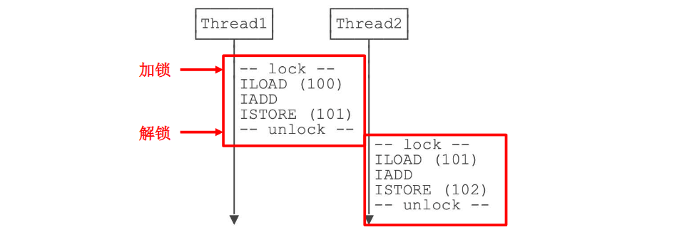

也就是用到前面说的synchronized关键字对一个对象进行加锁

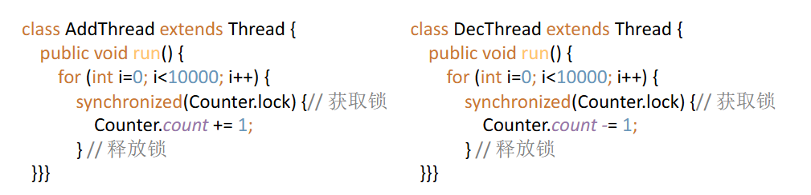

在使用锁的时候，要注意会出现死锁现象。在线程A中，持有蓝色钥匙想要红色钥匙，在线程B中，持有红色钥匙想要蓝色钥匙，这种情况下两个线程就会永远等待下去。

为了避免死锁现象，需要让线程获取锁的顺序一致，即按照先获取蓝色钥匙，再获取红色钥匙的顺序，这样可以保证一个进程获取蓝色钥匙后，另一个进程会正常被阻塞。

## 任务

任务一般由Runnable和Callable来实现，Runnable封装的任务没有参数和返回值，Callable封装的任务有返回值

对于一个Callable接口，需要实现call方法，同时用`Callable<Integer>`这种来表示返回Integer对象，可以抛出异常但不能直接进行线程操作（需要FutureTask做转接）。

```
Callable<String> callable = new Callable<String>(){
  public String call() throws Exception {
    return "Hello World";
  }
};
```

FutureTask可以将Callable间接转换成成Runnable，进而可以通过Thread启动线程。同时其继承Future接口，Future接口中定义了get方法等待获得结果的方法，可以用来获取返回值。

```
FutureTask<String> task = new FutureTask<String>(callable);
new Thread(task).start();
String call = task.get();
```

## 线程池

拼房创建终止大量线程会带来大量开销，线程池就可以解决这个问题。

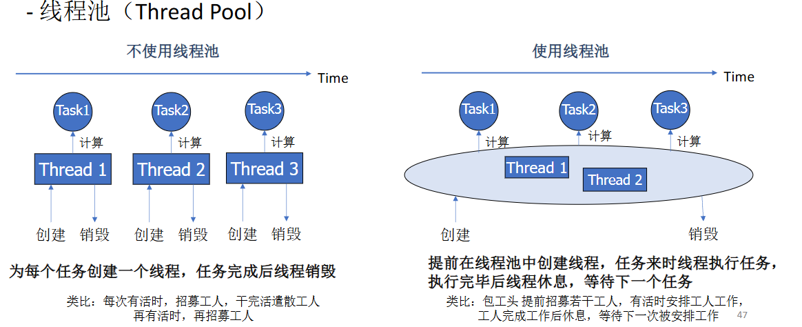

线程池简单来说，就是将多个线程打包到一起，统一创建和销毁，任务都可以通过线程池进行计算，当没有任务时对应线程会进入休眠状态而不是直接销毁。

线程池ThreadPoolExecutor继承AbstractExecutorService继承ExecutorService继承Executor。

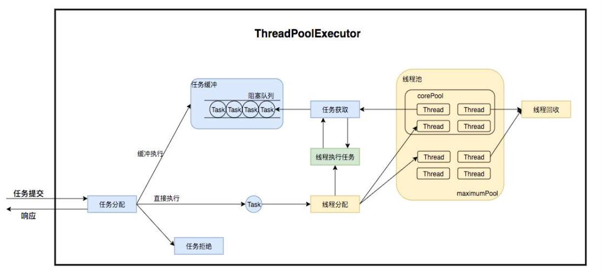

ThreadPoolExecutor线程池的主要参数有：

corePoolSize线程池中所保存的核心线程数

maximumPoolSize线程池中允许的最大线程数

keepAliveTime线程池中的空闲线程所能持续的最长时间（核心线程不会终止，非核心线程空闲到达最长时间后就会终止）

workQueue阻塞队列

threadFactory创建线程的工厂，主要定义线程名

```
new ThreadFactory() {
    int count = 1;
    @Override
    public Thread newThread(Runnable r) {
        return new Thread(r, "员工-" + count++);
    }
}
```

handler拒绝策略

在线程池工作时，首先检查运行状态，确保线程池正常运行，若正在运行的线程数量小于核心线程数，那就创建启动一个线程来执行任务；若任务数大于核心线程数，同时阻塞队列不满，那就放到阻塞队列中；若阻塞队列也满了，就创建启动一个非核心线程来执行任务；若线程总数也超了，即线程池满了，就根据拒绝策略来处理任务，默认为抛出异常。

# 泛型

泛型提供了编译时类型安全检测机制，该机制允许我们在编译时检测到非法的数据结构。即引入参数类型，将所有操作的数据类型被指定为一个参数。

```
ArrayList<String> list = new ArrayList<>();
list.add("str");
String name = list.get(0);
```

这里指定泛型string，当调用get方法的时候也不需要进行强制类型转换，编译器就知道返回的结果时String。

## 泛型类

即具有一个或多个类型变量的类。再类名后声明泛型，泛型类先声明类型变量再使用，类型变量通常用较短的大写比如T，E，K，V等等。

这里类型参数即类型变量可以看作占位符，在使用时将其替换为对应类型。

E：(Element) 元素  K：(Key) 键  N：(Number) 数字  T：(Type) 类型  V：(Value) 值

注意这里声明泛型也要用引用数据类型而不是基本数据类型，比如不能用int而是用Integer

`Generic<Integer> g = new Generic<>();`

```
class Generic<T> { //声明类的泛型 <T>
  public T t; //变量t的类型为泛型T
  public Generic(){}
  public Generic(T t){ //传入参数的类型为T
    this.t = t;
  }
  public void fun1(T t) {}
  public T fun2(T t) {} //函数返回值为类型T
}
```

## 泛型方法

泛型方法可以定义在普通类或者泛型类中，注意在泛型类中使用了泛型成员的方法不是泛型方法，泛型方法指的是声明了泛型的方法。使用泛型方法时，在方法名前的尖括号中填入具体类型。不过在多数情况下，方法调用可以省略类型参数。

```
class GenericFun{
  public <T,E> void fun1(E e){}
  public <T> T fun2(T t){
    return t;
  }
}
```

```
GenericFun g = new GenericFun();
g.<String>fun2("str") );
g.fun2(“str”) );//返回值为str
```

如果泛型方法的泛型与泛型类的泛型声明的名称一致，那么泛型方法中的泛型会覆盖类的泛型。

在类的静态泛型方法中，不得使用泛型类中声明的泛型，需要独立声明，这是由于泛型类的泛型是属于某个对象的，而静态方法的泛型是属于类的，所以如果使用了泛型类中声明的泛型，使用静态方法时并没有对象，因此无法确认这个泛型。

## 泛型接口

```
interface GenericInterface <T>{
    T fun1();
}
//实现类是非泛型类，需要指定接口的泛型
class GenericInterfaceImpl implements GenericInterface<String> {
    @Override
    public String fun1() {
        return null;
    }
}
//实现类是泛型类，则保证实现类的泛型声明与接口泛型一致
class GenericInterfaceImpl<T> implements GenericInterface<T> {
    @Override
    public T fun1() {
        return null;
    }
}
```

## 泛型通配符

泛型类型过于严格，一旦指定无法改变，有时需要允许参数类型发生变化，同时可以控制指定类型。

```
<? extends ClassName>  //类型参数是ClassName的子类
<? super ClassName>  //参数类型是ClassName的超类
<?>  //无限定通配符
```

通配符是在接收方使用的，在声明和定义时仍然正常定义。

```
class Box<T> {
    private T data;

    public void setData(T data) {
        this.data = data;
    }

    public T getData() {
        return data;
    }
}

Box<Integer> intBox = new Box<>();
Box<String> stringBox = new Box<>();

public static void printBox(Box<?> box) {
    Object data = box.getData();
    System.out.println(data);
}
```

## 反射

比如想要根据输入字符创建多个继承X的对象，这时需要大量if判断，反射即是通过Class类的一些方法来直接获知任意一个对象所属的类，或者构造任意一个类的对象，获知任意一个类所具有的成员变量和方法，或者调用任意一个对象的方法和属性

```
public static X create2(String name) throws Exception {
    Class<?> clazz = Class.forName(name);
    X x = (X) clazz.newInstance();
    return x;
}
```

Java在运行时，系统始终为所有对象维护一个运行时类型标识符，这个标识符会跟踪每个对象所属的类的完整结构信息，JVM根据这些信息选择要执行的正确方法。这里Class类就是类的类型，一个Class对象称为类的类型对象。

正常加载方式是：引入包类名称->new实例化->实例化对象。而所谓反射就是指这个过程倒过来：实例化对象->getClass方法->完整的包类名称。

Class类还包括了一个泛型，`Class<?>`泛型代表的就是Class所描述的类的类型。

`getClass()`方法，是Object类的一个方法，这个方法会返回Class类型的实例。

`getName()`方法，是Class的一个方法，这个方法会返回这个类的名字。

`forName(name)`方法，是Class的一个方法，这个方法会根据输入的字符串name返回一个Class<>对象。

`newInstance`方法，是Class的一个方法，这个方法调用默认的无参构造函数来初始化新创建的对象。

`Constructor`系列方法，是Class的一系列方法，这些方法可以获取Class所描述类的构造方法，返回Constructor类的对象。在Constructor类中也存在`newInstance`方法，这时就可以用Constructor的构造方法来构造对象。

```
// 获取当前类中所有 public 修饰的构造方法
// 返回 Constructor 数组，包含所有公开的构造方法
public Constructor[] getConstructors() { }

// 获取当前类中声明的所有构造方法（包括 public、protected、默认、private）
// 但不包括父类的构造方法
public Constructor[] getDeclaredConstructors() { }

// 获取当前类中指定参数类型的 public 构造方法
// 参数 parameterTypes 是构造方法的参数类型列表，可变参数
// 例如：getConstructor(String.class, int.class) 获取 public 构造方法，参数为 (String, int)
// 如果找不到对应的 public 构造方法，抛出 NoSuchMethodException
public Constructor getConstructor(Class... parameterTypes) { }

// 获取当前类中声明的指定参数类型的构造方法（包括 public、protected、默认、private）
// 参数 parameterTypes 是构造方法的参数类型列表，可变参数
// 例如：getDeclaredConstructor(String.class, int.class) 获取参数为 (String, int) 的构造方法，无论访问修饰符
// 如果找不到对应的构造方法，抛出 NoSuchMethodException
public Constructor getDeclaredConstructor(Class... parameterTypes) { }
```

`Field`系列方法可以获取和修改成员变量，返回一个Field类对象：

```
// 获取所有公有的字段
public Field[] getFields() { }

// 获取所有的字段（包括私有、受保护、默认的）
public Field[] getDeclaredFields() { }

// 获取一个指定名称的公有的字段
public Field getField(String name) { }

// 获取一个指定名称的字段，可以是私有、受保护、默认的
public Field getDeclaredField(String name) { }

// 使用Field类中的get(对象名)方法查看这个对象的字段值
// 使用Field类中的set(对象名，newvalue)方法修改这个对象的字段值
```

`Method`系列方法可以获取成员方法，返回一个Method类对象：

```
// 获取所有"公有方法"（包含父类的方法，当然也包含 Object 类）
public Method[] getMethods() { }

// 获取所有的成员方法，包括私有的（不包括继承的）
public Method[] getDeclaredMethods() { }

// 获取一个指定方法名和参数类型的成员方法
public Method getMethod(String name, Class<?>... parameterTypes)

//这是Method的方法。
//第一个参数是哪个对象来调用，静态方法第一个为null。
//第二个参数是调用方法时所传递的参数。
Object invoke(Object obj, Object... args)

```

`Constructor`,`Field`,`Method`对象，都可以通过`setAccessible(true)`的方法，将其中的私有的方法、变量等修改为可获取。

# 网络编程

java的网络功能通过几个不同的包实现，基本网络功能定义在java.net中，其中接口和类大致可以分为URL,URLConnection,Socket。

## TCP/IP

TCP：传输控制协议，是一种面向连接的、可靠的、基于字节流的传输层通信协议，TCP位于IP之上，应用层之下，保障了两个应用程序之间的可靠通信。

UDP：用户数据包协议，位于OSI模型的传输层，一个无连接的协议，提供了应用程序之间要发送数据的数据包，由于UDP缺乏可靠性且无连接，所以应用程序需要容许一些丢失、错误或重复的数据包

IP地址：互联网中，IP地址用于唯一标识一个网络接口，一台联入互联网的计算机一定有至少一个IP地址。IP地址分为IPv4和IPv6，分别是32位地址和64位地址。对于127.0.0.1，这是本机地址。

IP地址分为5类，不同的地址范围有不同用途

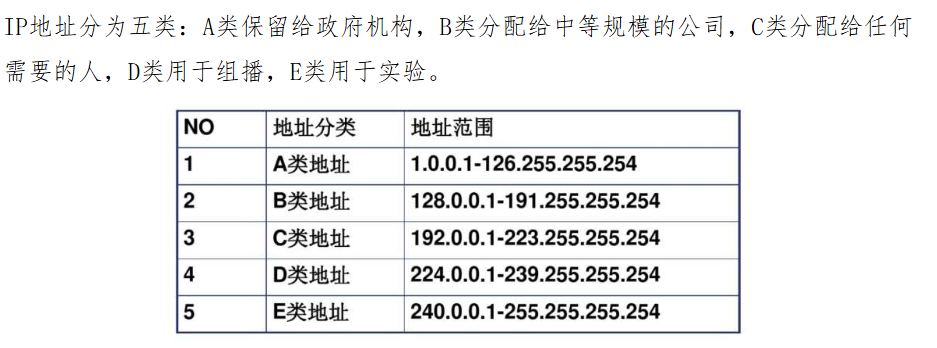

TCP/IP为了方便人们读取IP地址以及方便记忆，设计了一种字符表示地址的机制，叫做域名系统，即DNS

## Socket

Socket是一个抽象概念，是使用了TCP协议的通信机制，由一个端口号（应用程序）和一个IP地址（计算机）唯一确定。

在两台计算机之间使用Socket建立TCP连接时，会有下面这种过程：

服务器实例化一个ServerSocket对象，服务器调用ServerSocket类的accept()方法，等待客户端连接。客户端实例化一个Socket对象，指定服务器名称和端口号来请求连接，连接建立，服务器获得一个新的Socket对象，与客户端使用IO流进行通信。

也即ServerSocket是用来建立连接使用的，Socket是用来做实际传输的。

Socket对象可以可以通过getInputStream和getOutputStream等流方法，获取输入输出流，接着可以送入handle中进行传输。Socket流与本地的输入输出流操作起来没有本质区别，只不过从本地的设备转向了Socket。

Socket的输出流即从当前程序发送出去，输入流即输入到当前程序。

## URL

URL是统一资源定位符，简称网址。如：

`https://zh.wikipedia.org:443/w/index.php?title=1`

这里https是协议，zh.wikipedia.org是服务器也即域名，443是服务器的网络端口号，/w/index.php是路径，?title=1是询问。

可以在java中通过：

```
URL url = new URL("https://zh.wikipedia.org:443/w/index.php?title=1");
BufferedReader reader = new BufferedReader(new InputStreamReader(url.openStream()));
BufferedWriter writer = new BufferedWriter(new FileWriter("info.html"));
String line;
while((line = reader.readLine()) != null){
  System.out.println(line);
  writer.write(line);
  writer.newLine();
}
reader.close();
writer.close();
```
