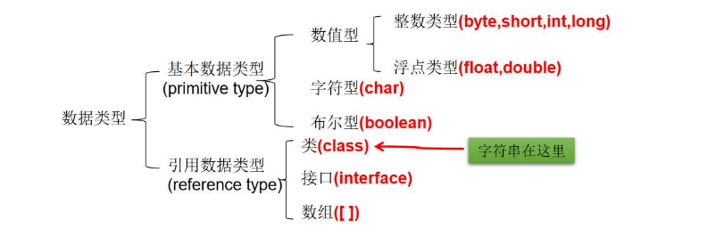
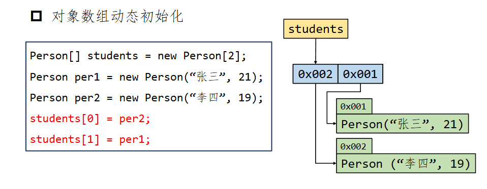
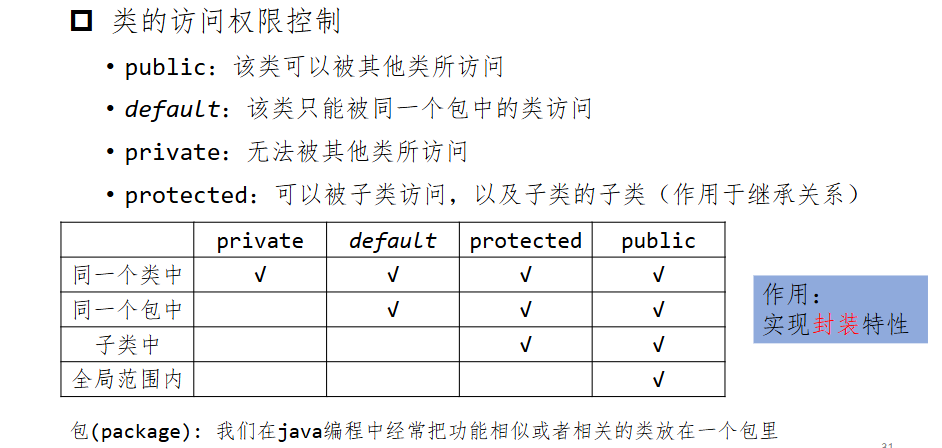
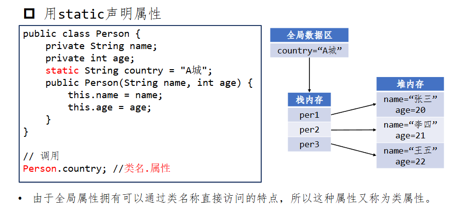
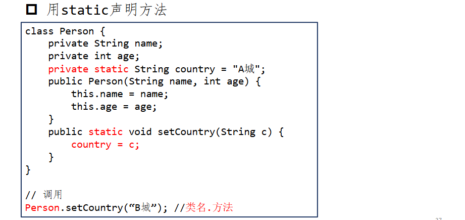

# JAVA基础

java是一个面向对象的编程语言，面向对象使其具有三大特征，分别是封装、继承、多态。

## Java环境

Java Development Kit (JDK)，JDK是Java语言的软件开发工具包，包含一批用Java开发的组件JVM、JRE、jar等等。

Javac：编辑器，将.java代码编译成.class字节码。

jar：多个.class+配置文件+资源文件打包成app.jar文件，

Java：运行工具，运行.class字节码，将.jar文件解析回.class并运行在JVM上。

Maven：依赖管理与自动化构建。通过pom.xml声明需要哪些jar，管理自动构建流程，管理项目结构


| `mvn clean`   | **删除上次构建产物**`target    |
| ------------- | ------------------------------ |
| `mvn compile` | **编译**`src/main/java`        |
| `mvn test`    | **编译并运行单元测试**         |
| `mvn package` | **编译、测试、打包成 jar/war** |
| `mvn install` | **打包并安装到本地仓库**       |
| `mvn deploy`  | **上传到远程仓**               |

手动运行java时，首先将.java用javac变成class，接着用-cp指定JVM去哪找.class，用java运行

```
javac -d bin src/App.java
java -cp bin App

#需要找jar包时
java -cp .;lib\some.jar App
```

一个用maven管理的java项目链路

有一个 Maven 项目：

my-app/
├── pom.xml
└── src/
├── main/java/
└── test/java/
执行 `mvn clean package`

Maven读取pom.xml，检查本地仓库是否存在需要的依赖，若没有则从Maven Central或配置的镜像仓库下载。
调用javac，把main中的.java编译成.class。
执行test中的单元测试
把编译产物、资源文件打包成.jar
运行项目

## Java基本数据类型

按照数据类型可以将变量分为两类：基本数据类型和引用数据类型



整型常量默认为int，声明long需要在数字末尾加l或者L
浮点型常量默认为double，声明float需要在数字末尾加上f或者F

字符类型char，用单引号`''`围住声明

布尔型boolean，只允许取值true/false，不允许用0或非0数替代true/flase

## Java控制流程

条件语句

```
int a = 100;
if(a == 100)
{
    System.out.println(a);
}
else
{
    System.out.println(a+1);
}
```

循环语句

```
while（x <= 10) {
  sum += x;
  x++;
}

for(int i=0; i<n; i++) {
  for(int j=0; j<n; j++) {
    break;
  }
}
```

跳转语句

break、continue、return

## 输入输出

标准输入System.in，System.in是一个InputStream类的对象。通常对其进行封装后使用

```
BufferedReader stdin = new BufferedReader(new InputStreamReader(System.in));
System.out.print("enter a Line: ")
System.out.println(stdin.readLine());
```

System.in是是对字节流进行操作，每次调用.read()的方法都是操作系统级别的调用，且一个字节一个字节读效率很低

InputStreamReader将字节流转换成字符流，即将字节映射到字符

BufferedReader将其加一个缓冲区，并可以按行读取其中内容

或使用java.util.Scanner封装

```
Scanner stdin = new Scanner(System.in);
System.out.print("enter a Line: ");
System.out.println(stdin.nextLine());
```

标准输出System.out，System.out是一个PrintSystem类的对象，可以通过print或者println来在控制台console中输出各种数据

## 数组集合

数组是一种对象，是动态创建的，存储相同数据类型的一组数据。数组的直接父类是object，可以在数组上使用object类的方法和属性，比如length属性。数组一旦初始化后，就相当于动态创建好了一个数组对象，其长度是不可变的。

用这种方式来声明数组，说明声明的数据类型是数组` int[] a = new int[2] {1,2};`

在用for遍历数组时，除了可以通过`for (int i=0;i<a.length;i++)`还可以通过`for (int n : a)`来遍历其中的元素。

对于多维数组，本质上可以想成一个存放数据类型是数组的一个数组对象，在这种想法下，多维数组不一定是个规则矩阵，而是可以对每个存放的数组都进行不同的初始化，即可以`int[][] arr = new int[m][];` `arr[0] = new int[3]; arr[1]= new int[1]; arr[2] = new int[2];`对二维数组中存放的三个一维数组分别进行初始化。

当然，二维数组本质就是对象数组，对于对象数组也有同样的特性，即除了对对象数组初始化，还需要对其中的对象分别初始化。数组中存放的是对象的引用，而并不是对象本身。



## 异常机制

Throwable是错误和异常的超类。

错误（Error）指程序中无法处理的错误，指运行应用程序中出现了严重错误，表示运行代码时JVM出现问题。通常有虚拟机运行错误，类定义错误，内存不足错误，栈溢出错误。这些错误是不受检异常，非代码性错误，因此程序不需要也不应该去处理这类错误，即我们不需要也不应该实现错误的子类。

异常（Exception）指程序本身可以捕获并处理的异常，主要分为运行时异常和编译时异常。
运行时异常是RuntimeException类及其子类，比如空指针异常、下标越界异常等等，这些异常即使没有被发现，没有用trycatch捕获或者throw抛出，也可以编译通过。
编译异常是除了RuntimeException以外的异常，是必须进行发现并处理的异常，如果不处理就会编译不通过，比如IOException、SQLException等等以及用户自定义的Exception异常。

异常处理可以通过` try catch finally`的方式来捕获并处理，try用来监听代码块，catch用于捕获try中的异常，finally用于回收try的资源，finally中的代码必然执行。

```
try{
//
执行程序代码，可能会出现异常
} catch(Exception e) {
//
捕获到异常并处理
} finally {
//
一定会执行的代码
}
```

也可以用throws，将其放在方法签名中，如果方法出现异常就直接抛出。

throw方法可以用来抛出异常

同时，我们可以在Java中自定义异常，只需要继承异常类即可`class MyException extends Exception`

```
import java.util.InputMismatchException;
import java.util.Scanner;

public class MyException extends Exception {
  public MyException() {
    super();
  }
  public MyException(String str) {
    super(str);
  }
}

public class exception_eg {
  public static void main(String[] args) {
    int score;
    Scanner input = new Scanner(System.in);
    System.out.println("请输入你的考试成绩：");
    try {
      score = input.nextInt(); // 获取成绩
      if(score < 0) {
        throw new MyException("成绩为负！");
      } else if(score > 100) {
        throw new MyException("你的优秀已经溢出了！");
      } else {
        System.out.println("你的成绩为："+score);
      }
    } catch(InputMismatchException e1) {
      System.out.println("输入的成绩不是数字！");
    } catch(MyException e2) {
      System.out.println(e2.getMessage());
    }
  }
}
```

## Java虚拟机

JVM就是Java虚拟机，通过软件模拟Java字节码的指令集，是Java程序的运行环境。通过JVM可以实现Java程序一次编译后，就可以在任何含JVM的主机上运行。

JVM将堆内存划分成三块区域，新生带，老年带，元空间。

JVM实现了自动的垃圾回收系统，垃圾回收主要对象是JVM堆空间。垃圾回收器持续跟踪Java对象，当某一对象不可达后，回收该对象的内存，同时清理内存分配，回收内存碎片。

# 对象和类

## 基础实现

对象（Object）是可观存在的具体实体，具有明确的状态和行为。一个对象具有标识符、属性、操作三个特征，标识符使其区别于其他对象，属性表示对象的状态，操作表示对象的行为。

类（Class）是对现实中一类具有共同属性和共同操作的对象的抽象。类是对象的抽象，对象是类的具体实例。类是静态存在的，对象是在程序运行时动态创建修改删除的。

类在声明时具体格式为：

```
[类修饰符] class 类名
{
    成员变量的声明;
    成员方法的声明;
}
```

其中类修饰符包括public、abstract、final。成员变量指类的属性状态，在整个类中有效，可以是基本类型也可以是引用类型，即可以在其中创建其他类的对象。成员方法是实现某一功能的程序，可以改变成员变量。

成员方法在声明时具体格式为：

```
访问控制修饰符 其他修饰符 返回值类型 方法名([参数类型 参数, ...])
{
    //方法
}
```

其中访问控制符包括public，private，protected，default。可以控制这个成员方法的访问范围。



为了实现类的封装性，一般需要保证类内部定义的属性和方法在外部不能被直接调用。

对于类中的属性，一般需要设置getter、setter方法对属性进行访问。将属性设为private，同时设置public的getter、setter方法。

```
public class Person{
  private String name;
  public void setName(String n)
  {
    name = n;
  }
  public String getName()
  {
    return name;
  }
}
```

在类中，都需要有一个构造方法，用来实现初始化该类对象时的方法，即new一个类的对象时，会调用的方法。为了区分方法的参数和类的属性，可以用this来代指当前类，用`this.属性名`在方法中访问类的属性。同时，类可以有一个或多个构造方法，但是不同构造方法之间一定要有参数类型或者数量的不同。

```
public class Person{
  private String name;
  public Person(String name)
  {
    this.name = name;
  }
  public Person()
  {
    this.name = 'LiMing';
  }
}
```

类还可以继承已有的类或者抽象类，可以通过`extends`来实现继承，同时可以在子类中使用super方法来复用父类的构造方法。

```
class Student extends Person{
  private int id;
  public Student(String name,int id)
  {
    super(name);
    this.id = id;
  }
}
```

同时，可以用super来访问父类的成员，与this的用法相同，通过`super.X`的方式访问

在使用修饰符时，有一个static修饰符，这种修饰符表明这个属性或方法时属于类的静态属性或方法，这个成员属于类而不是具体的对象，随类加载时被静态分配内存。





使用static声明的方法，不能访问非static的操作或方法，非static声明的方法，可以访问static的属性或方法。同时一个类中的属性和方法如果都是非static类型的，那么一定要有实例化对象才可以使用。

同时可以在类中定义静态块，静态块中的内容只会在类被加载时执行，后续创建对象实例时不会再调用。

## 抽象类和接口

对于父类的一些属性和方法，暂时还无法确定，这时可以将其定义为抽象方法`public abstract void getMission();`不设置方法体。含有抽象方法的类叫做抽象类，抽象类不能直接实例化。抽象方法可以起到占位的作用，定义规范，并通过继承可以实现多态。

再进一步抽象，抽象类中的抽象方法本质是定义了接口规范，子类实现这个方法要遵循相同的接口实现规范，因此可以定义一个接口，接口的所有方法都是抽象方法，且没有属性，其本质相当于一个抽象方法的集合。

接口通过interface定义

```
interface Person{
  void getDuty();
  void getMission();
}
```

当一个类实现某个接口时，可以用implements实现。

`public class Student implements Person{}`

一个类可以继承多个接口，因此可以解决抽象类无法多继承的问题。

## 多态

多态指同一个行为具有多种表现形态。可以通过重写，抽象类抽象方法，接口这三种方式来实现。

当父类中的某些方法在一些子类上并不能直接使用时，可以通过重写(override)父类中的方法，在保证名称、参数、返回类型不变的基础上，仅修改其内部实现，来实现多态。在子类重写的方法前加上`@Override`可以让编译器帮助检查是否进行了正确的重写。

当知道一个父类方法大概率会在后续不同子类中都进行重写的时候，可以将父类方法直接定义为抽象方法，这样可以无需在父类中写抽象方法的实现，在子类中直接重写。

## 多继承

Java只允许类之间的单继承，为了实现多继承，可以通过内部类或者接口来实现。

内部类指在要多继承的类中，分别创建多个继承要继承类的子类，并通过在这个类中new这些子类的对象，实现在一个类中使用多个类。

```
public class Son{
  class FatherInner extends Father{
    public int strong(){return super.strong() + 1;}
  }
  class MotherInner extends Mother{
    public int smart(){return super.smart() + 1;}
  }
  public int getStrong(){return new FatherInner.strong();}
  public int getSmart(){return new MotherInner.smart();}
}
```

也可以用接口实现，由于一个类可以使用多个接口，一个接口也可以继承多个接口，因此可以通过先定义接口之间的多继承，接着让这个类使用多继承后的接口。

```
public interface Father{
  public void strong();
}
public interface Mother{
  public void smart();
}
public interface Daughter extends Father, Mother{
  public void kind();
}

public class Girl implements Daughter{
  public static void main(String[] args){}
  @Override
  public void strong(){
    System.out.println(“She’s not strong.");
  }
  @Override
  public void smart(){
    System.out.println(“She’s very smart.");
  }
  @Override
  public void kind(){
    System.out.println(“She’s very kind.")
  }
}
```

## Object超类

超类Object是java中所有类的始祖，所有类都是Object的扩展，可以使用Object的所有方法。

因此可以用Object类型的遍历引用任何对象
`Object obj = new Student(“Zhangsan", 19);`
不过想要对这个对象进行操作，则还是需要将其强转为其真实的类型
`Student Zhangsan = (Student) obj;`

Object类中有一个equals方法，这个方法可以用于比较两个对象是否相等，其比较方式是通过判断两个对象的引用是否是指向的同一个对象来判断，这要提到在java中对于引用对象，`=`的实际含义就是引用，即将左侧对象的引用设置为右边对象的引用，这种情况下对左侧修改等操作时就相当于对右侧进行了修改等操作。
