# 概率模型

模型：对研究对象抽象化理想化简化的表述

概率模型：计算事件的概率的模型

概率语言模型：对文字和句子赋予一个概率

## MLE最大似然估计

频率可在一定程度上用来估计概率，进而得到参数，即通过实验得到的频率可以来估计参数

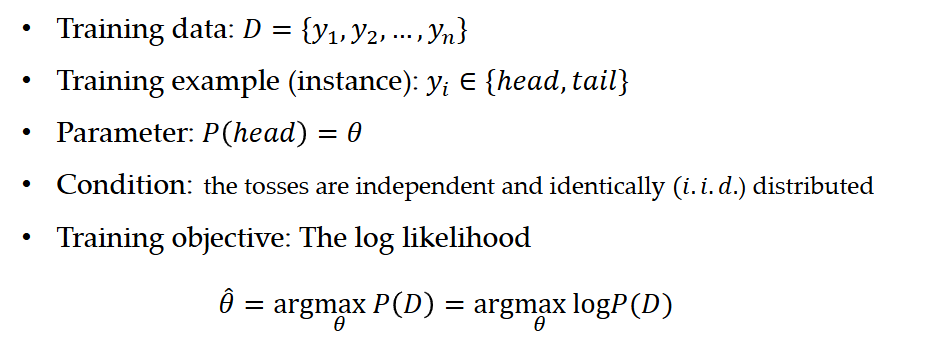

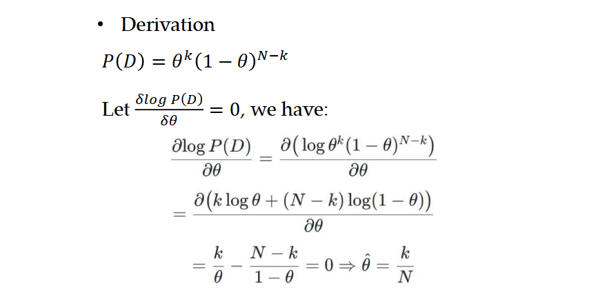

通过最大化训练数据的概率，得到概率分布的参数

## 字的概率模型

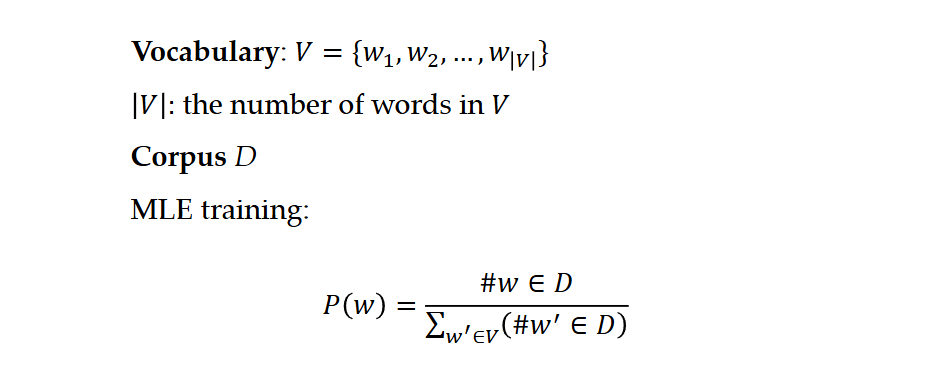

词 w 的概率 = 词 w 在语料 D 中出现的次数 ÷ 语料 D 中所有词出现的总次数

这里能用频率估计概率就是来源于MLE，即使得这个语料出现的概率P(D)最大的最优解就是各个字按照出现频率的概率分布

## 概率分布

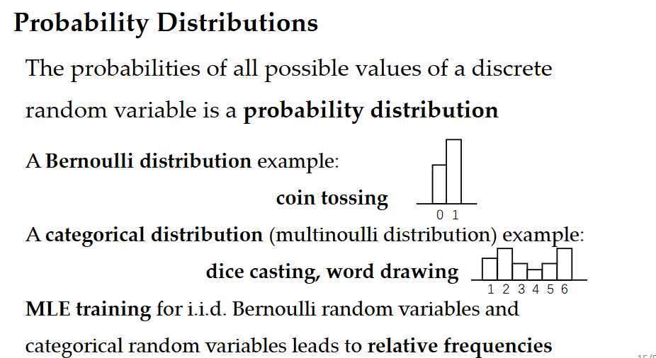

对随机事件进行变量化，变量不同值代表不同事件发生，得到随机变量

设置一个可计算的方程用来计算概率，其中可包含模型参数

对于随机变量每个值都通过方程得到其概率，进而得到随机变量概率分布

通过MLE的算法得到的结果，对于伯努利独立同分布和多项分布，最后各参数（这里指各结果出现的概率）最优结果都是各结果的出现频率

举例来说，对于一个伯努利实验，模型参数为θ，方程即 P(X=1) = θ，进而就可以得到概率分布。接着对于一个结果集D={1，1，1，0，0，0}，P(D)可以通过概率分布得到，进而通过MLE，对θ优化，使得P(D)最大，这时候得到的优化θ即D中1出现的频率，也即0.5。于是就完成了模型从数据中学习到模型参数的过程

除了这些简单分布，实际过程中还会出现其他各种分布，以及更多无法简单表示的分布，但是只要设置好模型参数、方程，给定训练数据D，给定训练方法（MLE），就可以进行最优化进而学习到模型参数

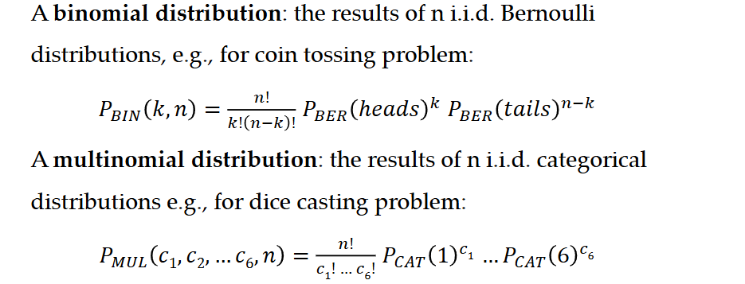

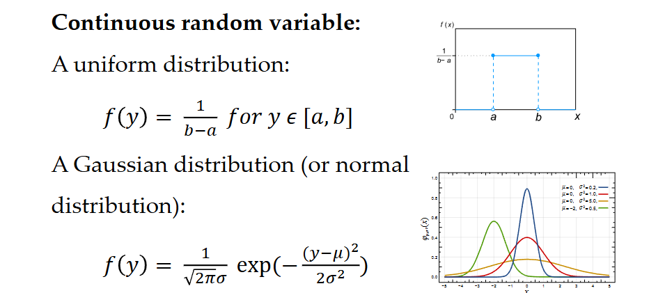

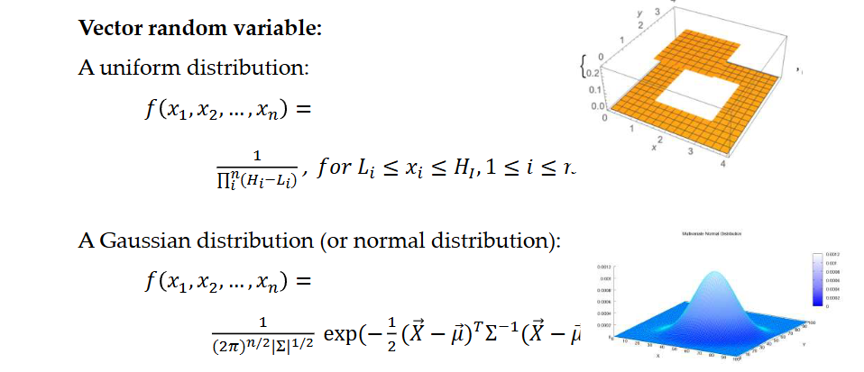

# N-gram语言模型

总结一下，这个过程主要是两步，第一步是训练过程、第二步是打分过程。

在第一步，通过对训练数据进行统计，并由于MLE用频率来表示概率，对模型进行训练

在第二步，通过得到的概率，进行一定的平滑过程降低稀疏性，接着用特定的方式对句子进行打分。在N-gram中是通过计算句子出现的概率来打分，当然这里是通过一定的假设（比如独立性假设和马尔可夫假设等等）对概率进行的估计。除此之外还有交叉熵打分等等。

## Uni-gram

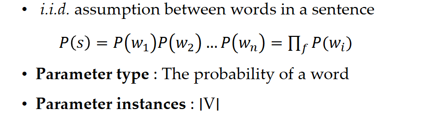

符合独立同假设，一个句子的概率等于各字出现概率的乘积

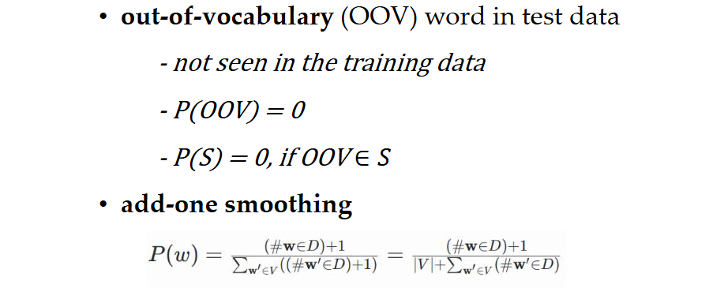

对于不在训练数据中但是出现在测试数据的字，即OOV，其概率为0

可以通过在计算字概率时对于每个字出现次数都加上一个相同常数来进行平滑处理

这样可以解决OOV问题，若不加常数则会出现0概率，这在连乘的场景是非常危险的，加上常数后则概率永不为0，且能保持原有的概率顺序

## Bi-gram

在句子中，单纯计算每个独立词的概率在很多时候无法很好地表示上下文信息，使得结果偏离实际，在bigram中，使用条件概率来尝试解决这种问题，已知前一个词，下一个词出现的概率是什么

通过MLE对条件概率优化，结果为

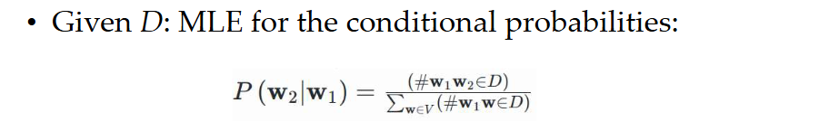

但是由于将数据引到了平方，很多匹配方式可能并没有在训练数据中出现，比如”喝“，”饭“并没有连续出现过，于是计算其条件概率就会为0，这就是稀疏性。

为了减少稀疏性，可以通过回退的方式，即将二阶模型回退到一阶，并用超参数来表示回退程度

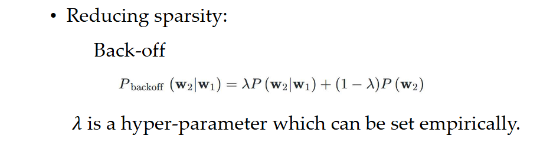

句子一般都存在起始符和结束符，计算可以得到一个句子出现的概率等于各个条件概率的乘积。通过在训练数据中得到各个条件概率，就可以得到测试数据中的句子的出现概率

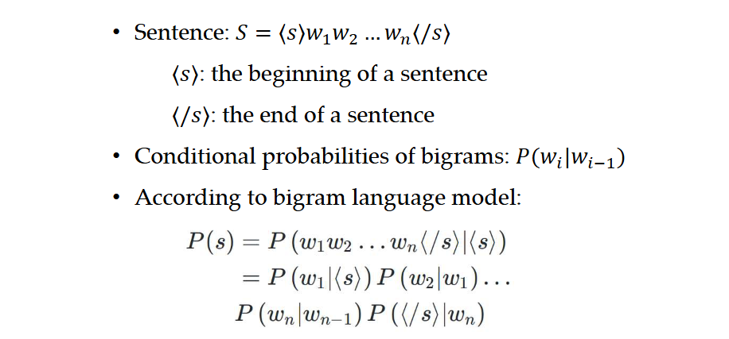

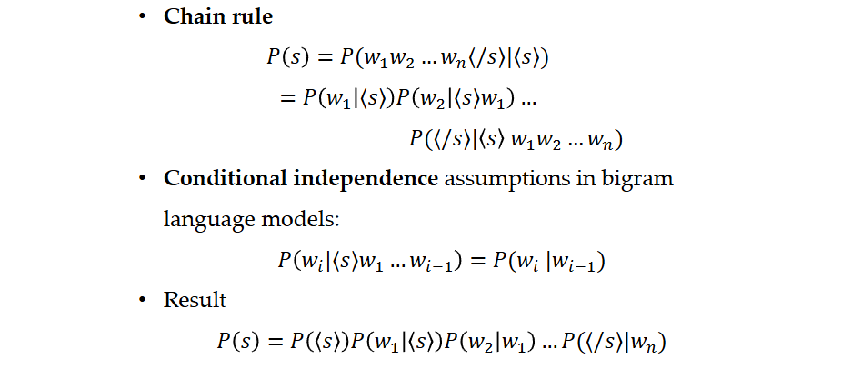

## Tri/Multi-gram

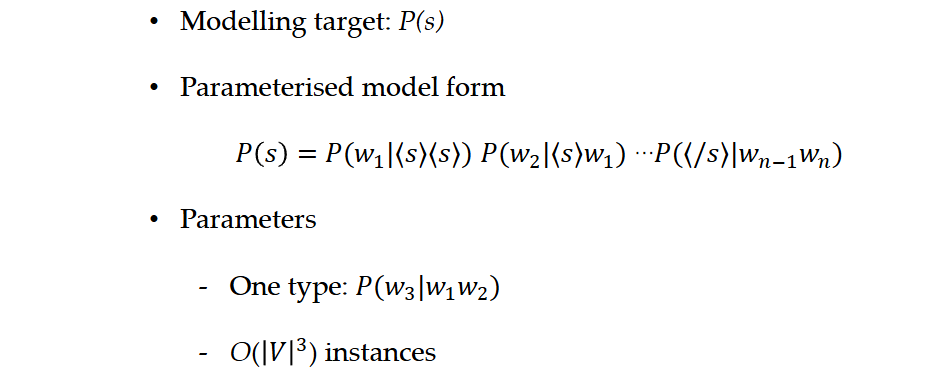

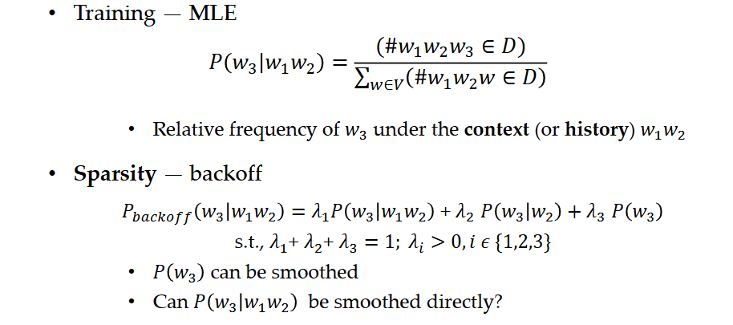

## 生成式模型

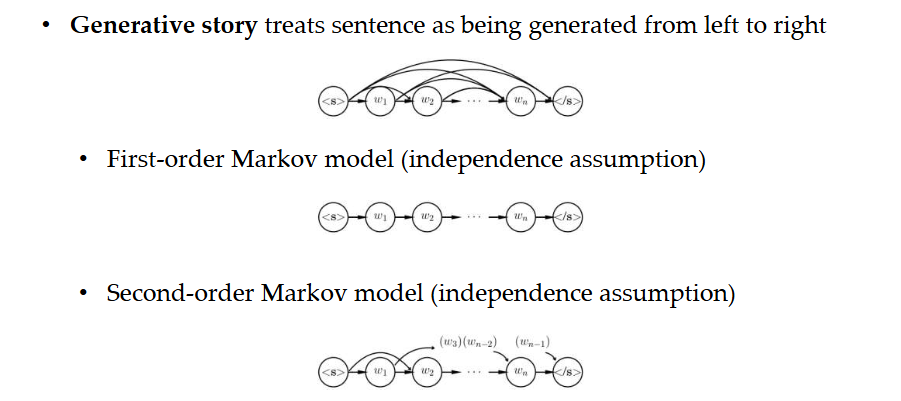

# 朴素贝叶斯模型

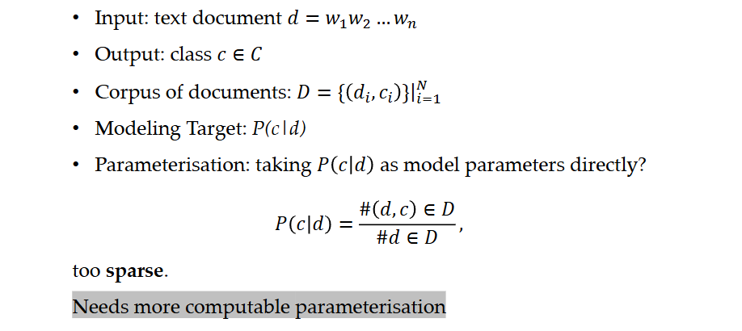

正常分类思路是通过训练数据中的N个句子类别对，训练得到句子d的c类别条件概率，但是经过MLE优化后，条件概率为d和c元组出现次数比d出现次数。但是实际过程中，不可能任意一个句子都在训练数据中出现，也不可能任意一个句子类别对都在训练数据中出现，因此稀疏性过强，大部分得到的条件概率都是0，需要找其他的办法

## 贝叶斯分类

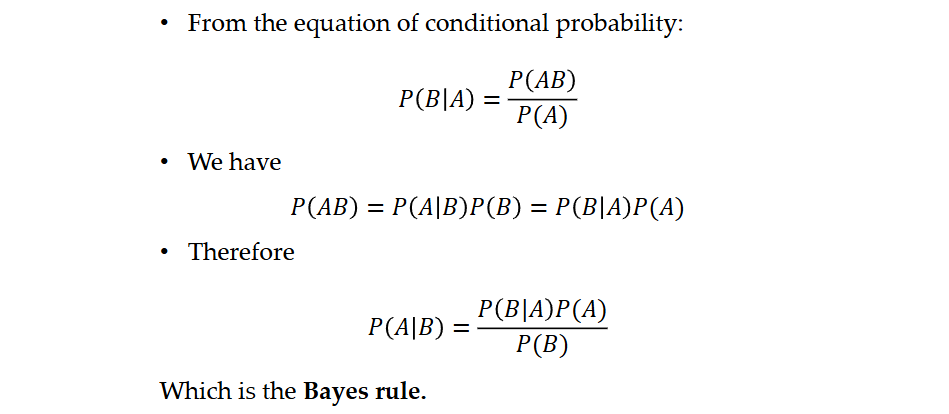

**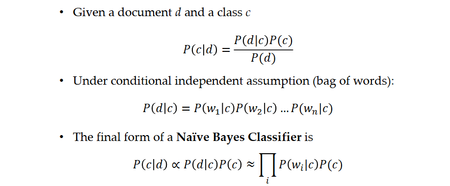**

通过贝叶斯处理，将句子的概率从条件变成分析对象，接下来就可以进行展开，将句子概率展开成字的概率

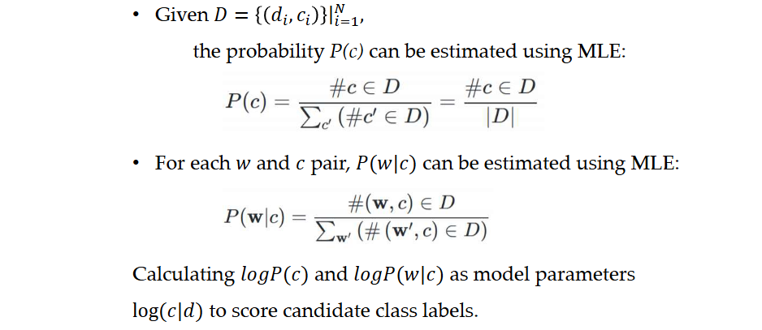

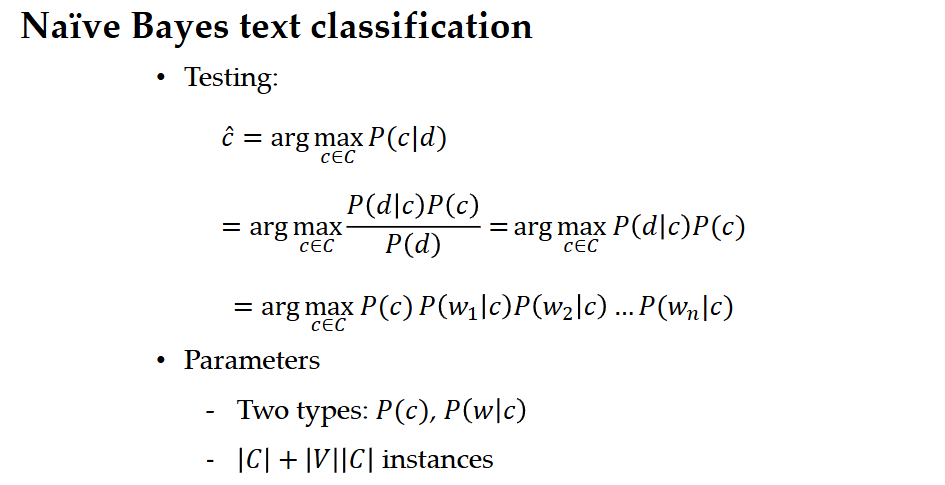

即在训练数据中得到类别c条件下各个字的概率以及类别c的概率，就可以通过连乘得到一个句子属于这个类别的概率

## 分类模型的评价

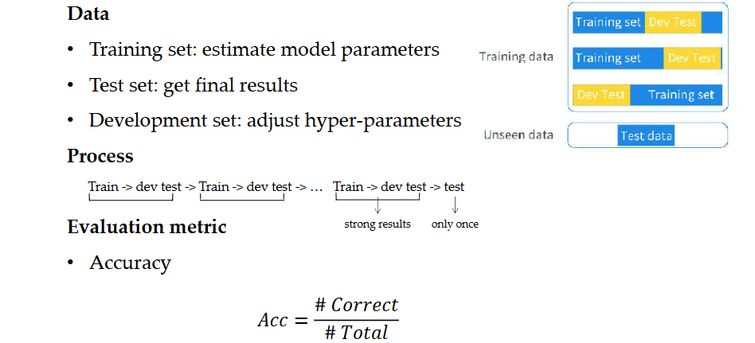

设定训练集、测试集、评估集。

在训练过程中，不断通过评估集检测当前训练效果。

通常用准确率ACC来衡量训练效果

## 特征

特征简单来说就是模型的参数

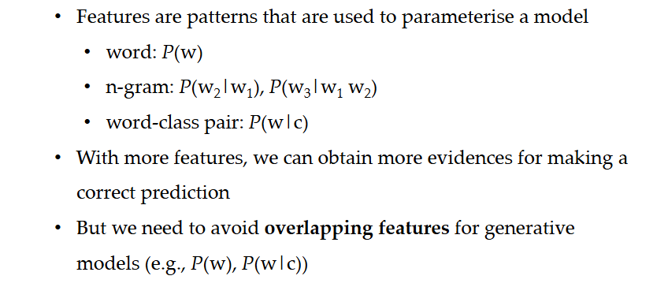

这里提到了特征之间要保证独立不重叠。实际上这是由于在朴素概率生成式模型中，通常需要对特征进行乘算，若特征之间有重叠则会出现同一个隐藏参数被多次乘算的情况。

同时，对于bigram中的回退算法，看似也使用了重叠的特征，但实际上两个重叠特征并没有进行乘算，而是借助超参的选择加算，是不会有影响的。

# 向量空间表示

## 特征向量

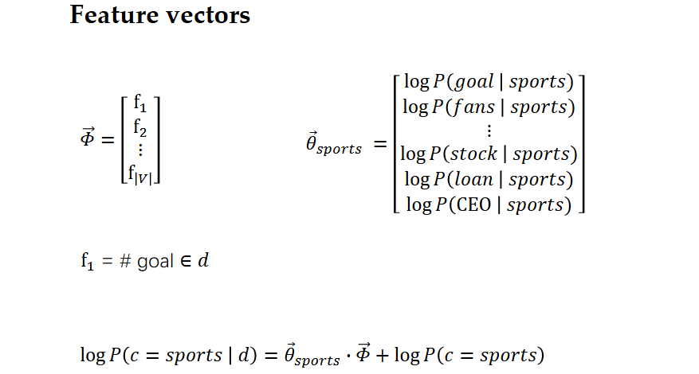

从贝叶斯分类中，可以得到一个句子属于类别的概率可以用一个类别条件下各个词出现概率的乘积表示，于是也可以用词汇表进行映射，即词汇表中各词在句子中的出现次数和各词在这个类别中出现的概率点乘

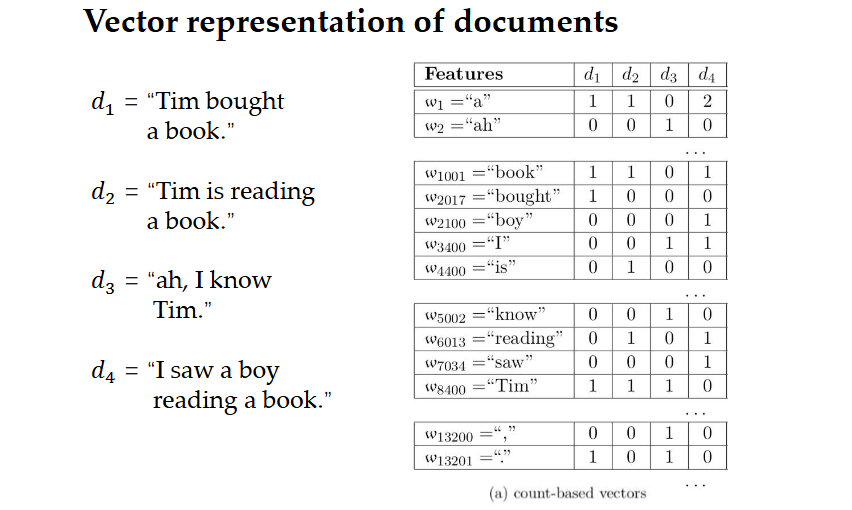

在这种表示下，各词在各类别中的出现概率可以通过训练数据统计得到，而各词在句子中出现次数即可作为这个句子的特征向量，可以用这个向量来代表这个句子

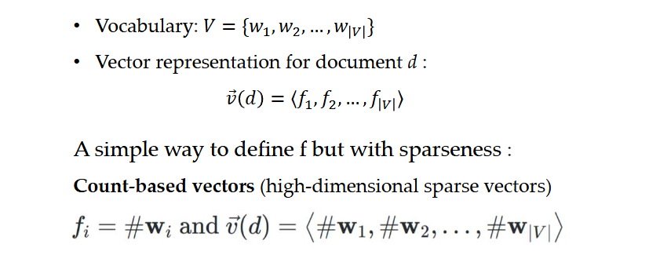

在这里会出现很多问题

一个问题是终止词问题，在句子中会出现大量重复出现但是没有实际意义的词（比如英语中“of”中文中“的”），这些词作为特征只会使得特征的区分度更低，因此在构建特征时通常需要人为去除这些停止词

另一个问题是其稀疏性，由于词汇表中存在大量在句子中未出现的词，特征向量会有大量的元素为0，表现稀疏性

对于终止词问题，可以通过TF-IDF来解决

## TF-IDF

其基本理念是，在训练数据集的大量句子中，若某个词在越多的句子中出现，就代表其信息越少，响应的特征权重就应该下降。

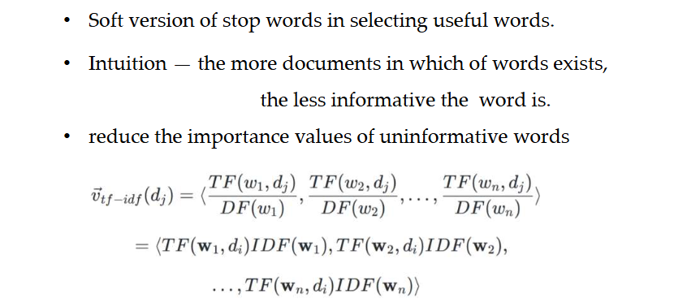

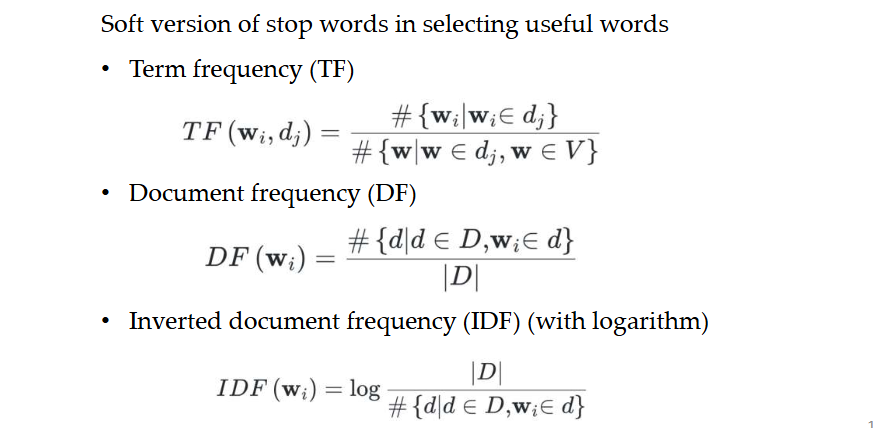

其中TF指这个句子中出现这个词的次数，DF指在整个训练数据集中有多少句子含有这个词，即权重项

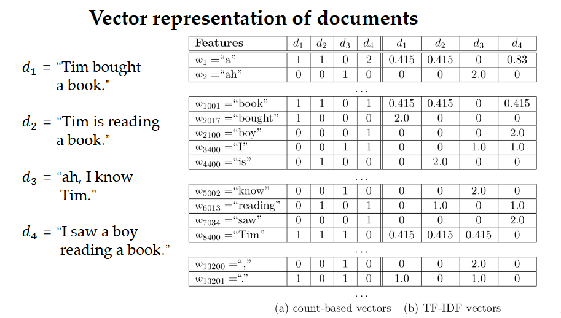

通过这种方式可以一定程度解决终止词问题，同时不需要人力操作

# 聚类模型

## 聚类

通过将句子或文章转化成特征向量，接着在向量空间中即可得到两个句子之间的距离

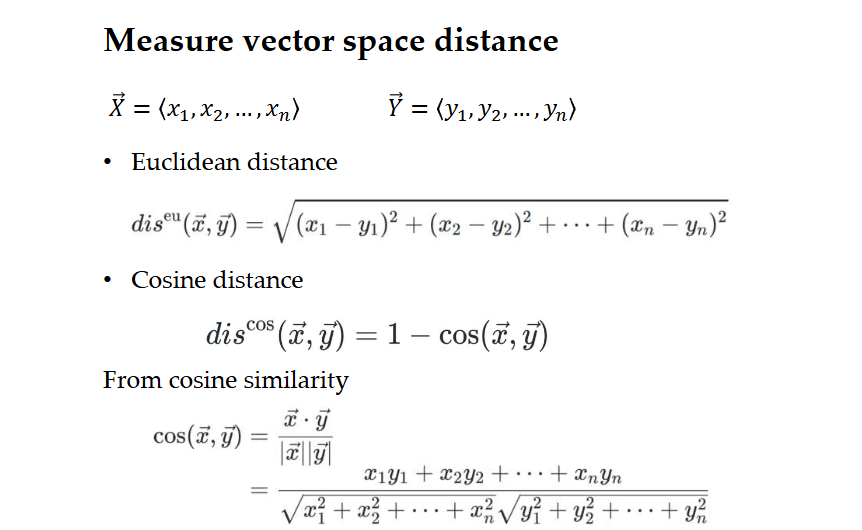

常用距离有欧几里得距离和余弦距离

利用一个距离计算方式，将距离相近的向量聚类

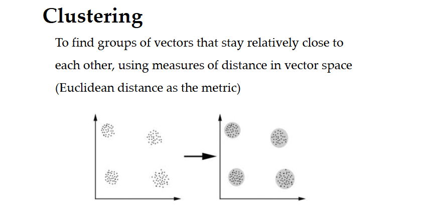

## K-means聚类

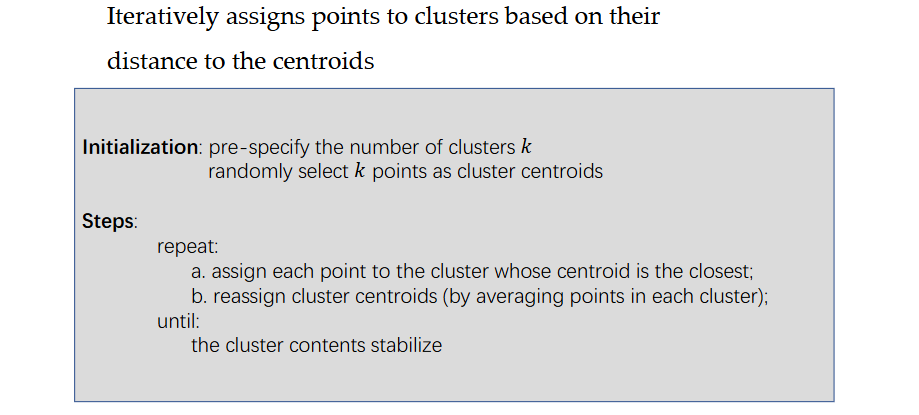

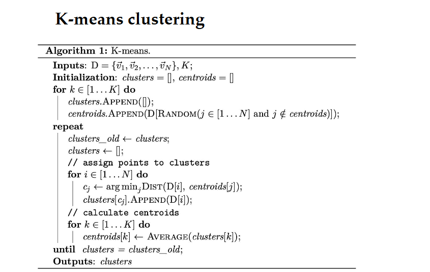

算法简单来说就是：

已知总共有k个类别，给定了一定量的训练数据，需要找到这k个类别在向量空间的具体位置。

1. 在整个向量空间中随机初始化k个类别中心点
2. 对于每一个向量，将其归类为距离最近的类别
3. 计算同一类的向量的平均值，作为类别新中心点
4. 重复执行2、3，直到不再出现新的变化

这是聚类的训练过程，在训练数据上训练找到类别在向量空间具体位置后，对于新的测试数据，就可以通过找到最近距离的类别来确定其所属类别

# 分类模型

## 分类和聚类区别

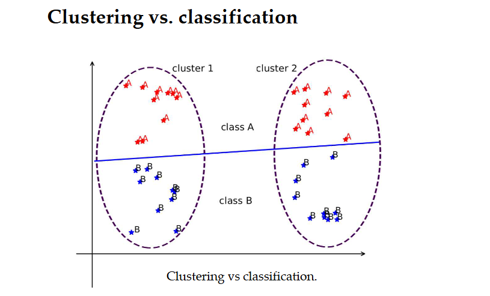

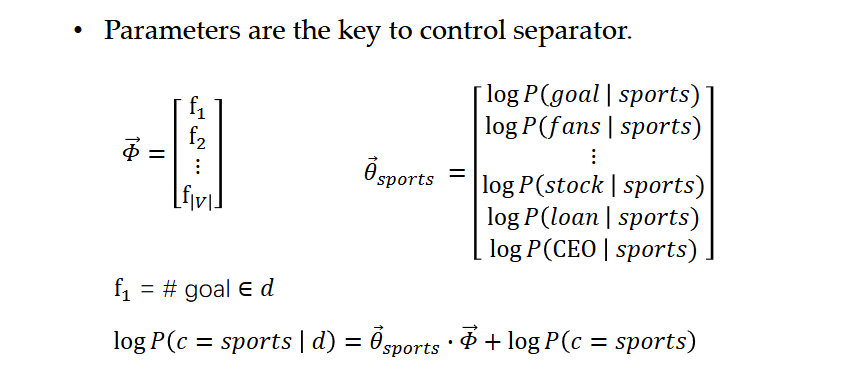

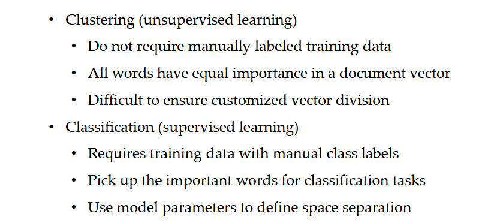

简单来说：

分类的训练数据是类别+句子；聚类只有句子

比如贝叶斯分类的过程是先在训练数据通过统计各个类别条件下各个词的概率，接着通过特征向量即可计算一个新的测试数据属于各个类别的概率，进而判断其属于哪个类别

比如Kmeans聚类的过程是先在训练数据得到k个类别在向量空间的具体位置，接着就可以通过计算新的测试数据与各个类别的距离来判断其属于哪个类别

## 感知机

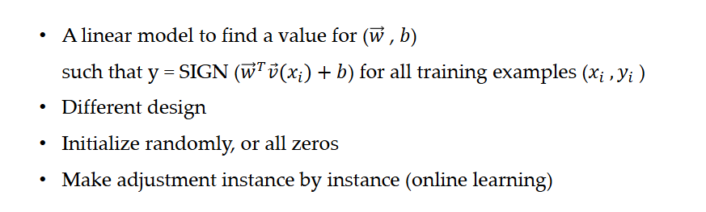

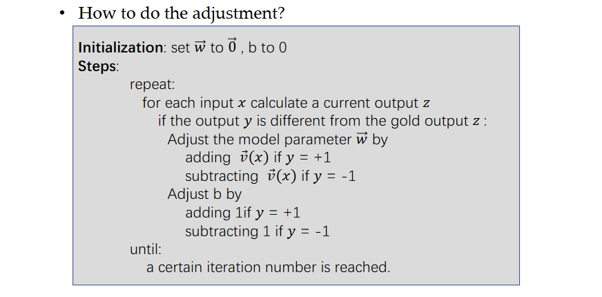

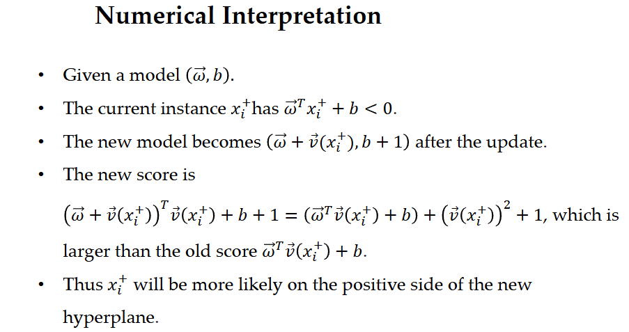

这是最传统的感知机，使用符号函数和线性函数复合而成，具有w,b两个参数，其中w与特征向量维度相同，与特征向量进行点乘后加上偏置b，最后经由符号函数得到正负1。

其学习过程即对w和b学习，通过原始（x,y）对，对x进行向量化后经过当前感知机得到的结果与真实的y进行比对，对w和b进行对应的调整学习。

其本质也是个分类模型，是个二分类，即结果为1还是-1的分类。通过学习w和b的参数，对于一个新的测试数据，可以较大概率预测出其所属的类别

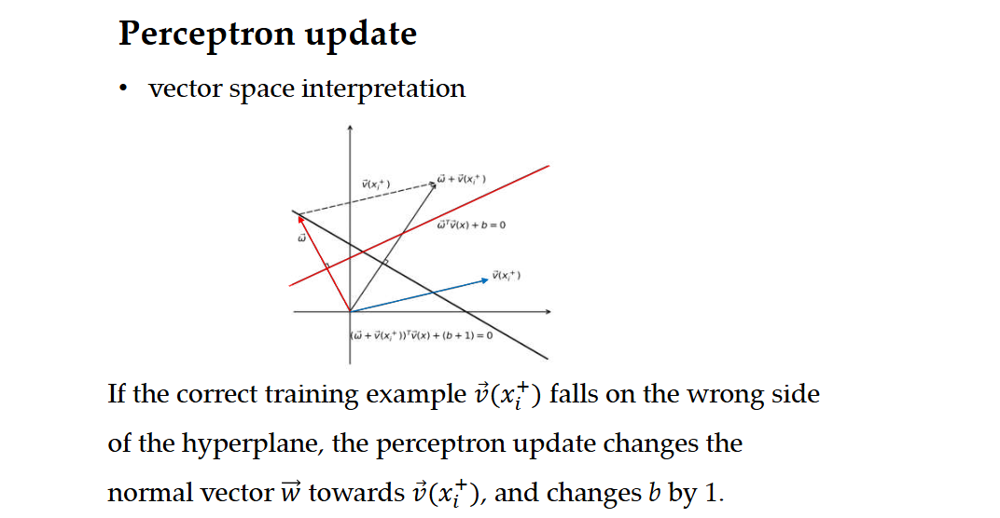

在向量表示中，可以看到，若wv大于0，则代表v与w（超平面法向量）同面向，于是更新方式为w减去v；同理，wv小于0代表v与w异面向，更新方式为w加上v

## 多分类问题

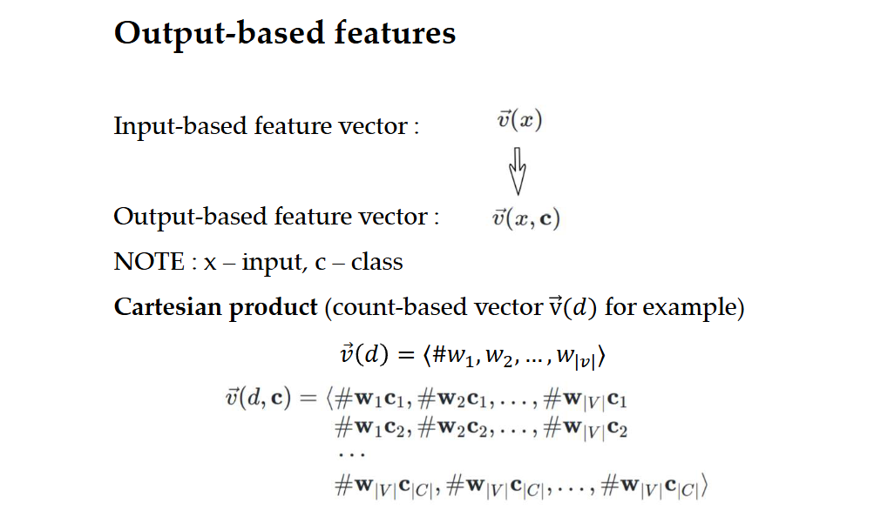

这里使用的方法是，将特征向量维度扩大，包含所有的类别。同理将权重w也扩大维度，包含所有类别下各个词的权重。

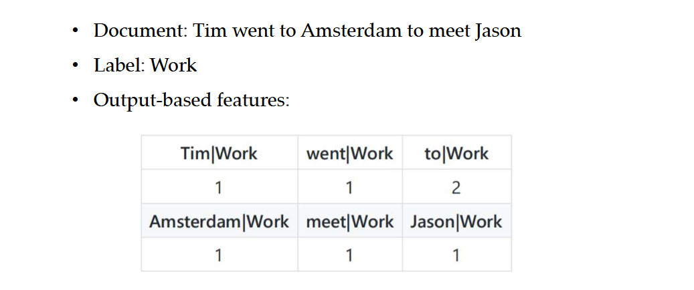

对于一个类别，其特征向量中只有对应类别的部分值可能大于0，其余类别的部分都为0，这也就能筛选掉权重w中其他类别的部分

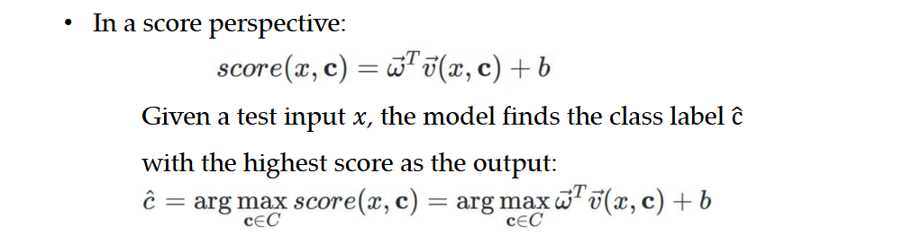

接下来对每个类别都计算分数，取分数最大的类别作为x所属的类别

在这种做法下，权重w的实际意义代表了一个词对一个类别的贡献值。

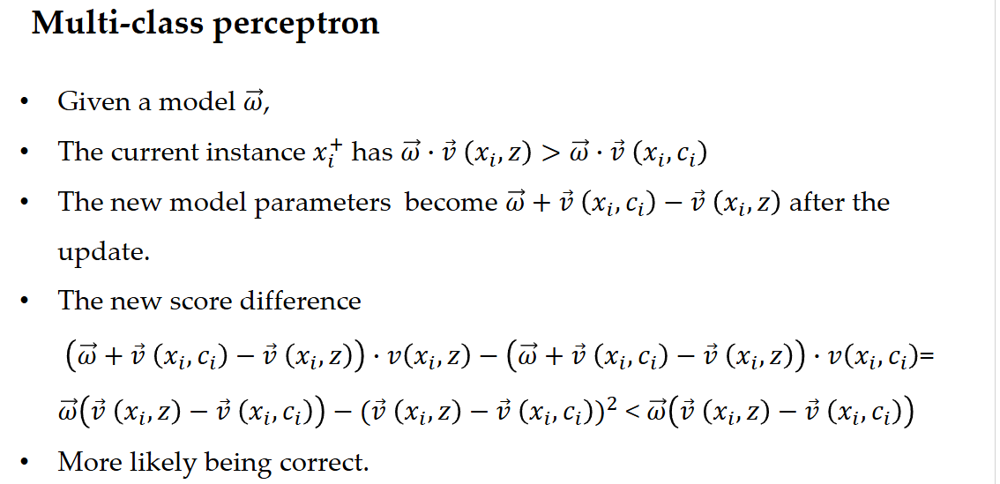

在多分类感知机下，可以简单想成原本的v被替换成了𝑣(𝑥𝑖, z)-𝑣(𝑥𝑖, 𝑐𝑖)，判断条件为新v与0的比较，w的更新为加减新的v

值得注意的是，由于新v代表的是xi在计算的z分类下的特征减xi在实际ci分类下的特征

# 判别式模型

感知机模型是判别式模型的一种（二元分类感知机，多分类感知机），朴素贝叶斯模型是生成式模型

统一起来说：目前学到的分类模型有两种，一种是贝叶斯分类模型，一种是感知机模型。贝叶斯分类模型中，会统计训练数据中的各条件概率，并最终得到数据条件下类别的条件概率来分类；感知机模型中，通过训练数据学习一个符号、线性复合函数，将数据直接映射到类别。

简单来说，生成模型学习中需要学到类别下数据的概率分布，关注数据的生成过程，在这个过程中已经可以生成一个类别的新数据了，分类所需要的数据下类别的概率只是后续过程。而对于判别式模型，其直接建模数据下类别的概率，在数据和类别之间直接建立映射。

更进一步，生成式模型在训练过程是MLE优化联合分布，而判别式模型在训练过程是MLE优化条件分布

## bigram 特征

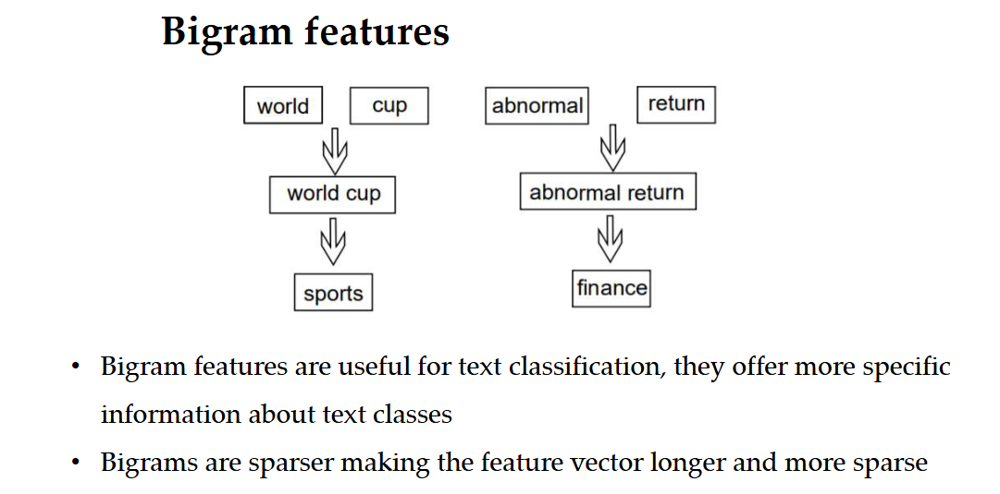

在判别式模型中，可以更简单地拓展特征向量，比如加入bigram特征，能使模型更精准。

在生成式模型如朴素贝叶斯中，一个重要假设就是特征之间独立分布，因此无法像判别式模型一样直接将bigram加入特征。

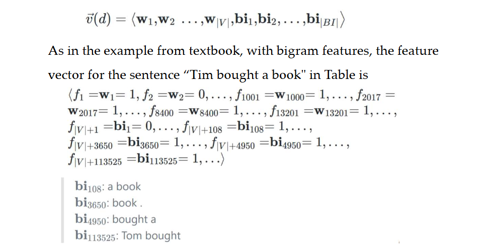

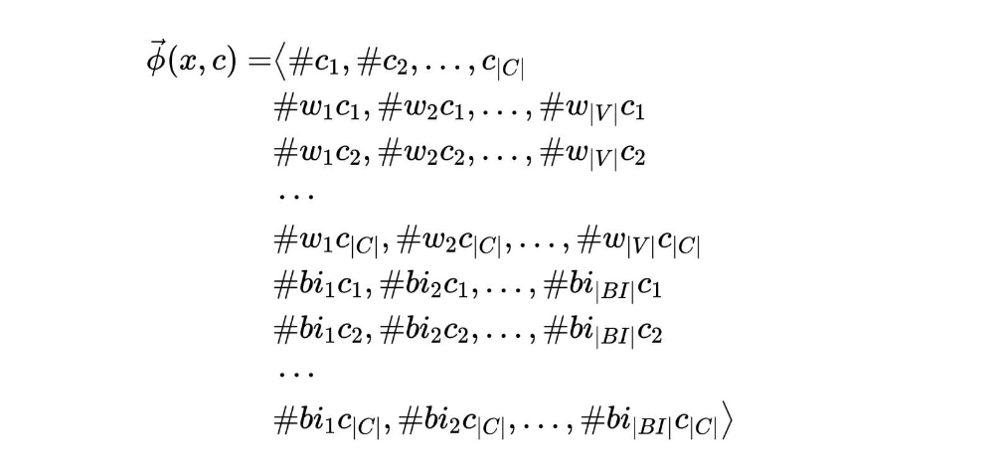

其使用起来也很简单，即在原始的单词特征后再加上双词特征即可。注意对应的w权重维度也会有变化

## 特征工程

由于判别式模型在特征上具有优势，想要充分发挥就需要找到合适的特征或者特征组

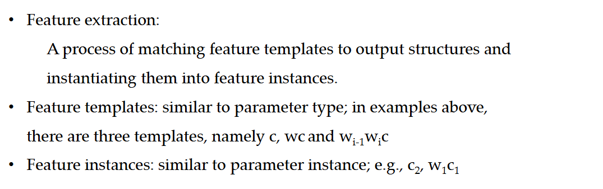

比如，可以使用当前词+类别作为特征，也可以用当前词+上一个词+类别作为特征，也可以用两个共同合成的特征组为特征，以及其他各种复杂的特征。

由于在判别式模型中允许特征之间重叠，因此可以先通过经验设置好观察的角度（即templates），再将其实例化（即instance）进行后续计算。

在特征工程中尤其要注意的是其线性可分性和泛化性

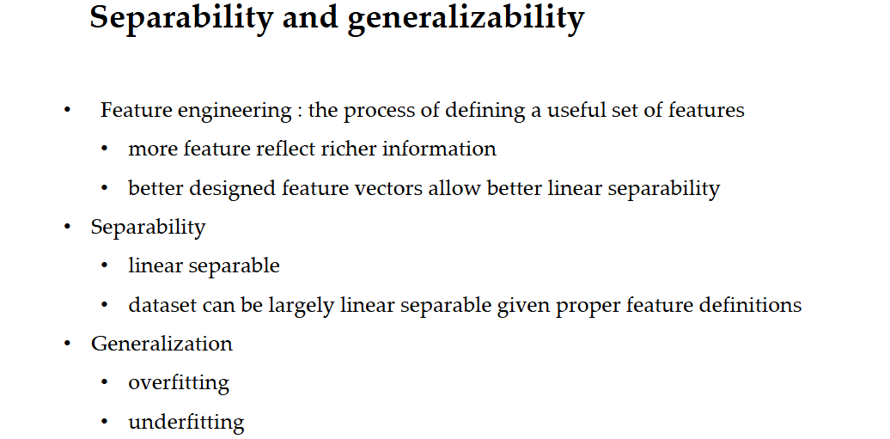

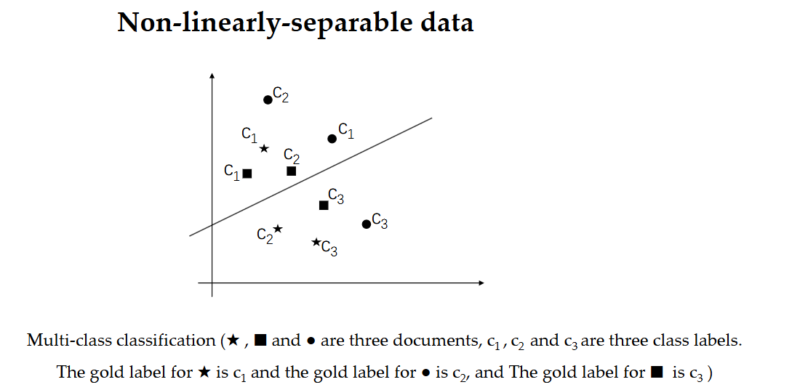

大部分数据都可以通过合适的特征设置实现线性可分，比如对于一个相同词，单使用这个词作为特征无法区分，但是可以通过加上上一个词，将特征引向更高维，进而做到可区分。

总结一下，判别式模型（如感知机），所做的就是：先利用特征工程，将原有数据映射到一个更大或者说更合理的高维空间中，进而通过感知机的更新过程对模型的参数进行更新，得到一个可以区分数据的超平面，达到分类的效果。

对于多分类问题，虽然表面上是一个wb参数对，但实际上其相当于为每一个类别都设置了一对wb，于是其本质就是找到多个超平面，对特征空间进行划分。

## 线性模型

不论生成式模型还是判别式模式，其都是线性模型。

线性模型可以简单理解为可由向量点积表示的模型

# log线性模型

## 概述

由于在朴素贝叶斯中，可以得到log的向量点乘形式，因此想到能否在设计感知机的线性模型时将线性加上exp以符合log点乘形式，这能使得感知机更符合贝叶斯概率的底层

简单来说，通过朴素贝叶斯两边log得到logP可由wb线性表示，因此可以对wb线性表示再进行exp来还原到原来的概率表示。

但是这里是忽略了概率表示自带的归一化因子，因此对于最后结果一般还需要进行归一化，这里常用softmax和sigmoid等函数来归一化

sigmoid本质是softmax变种，将二分类问题转为单元问题。

## log线性模型训练

通过MLE优化P(Y|X)，即已知X后Y出现的概率。进一步表示为各个p(y|x)对的积。而在模型中，这里使用sigmoid、参数θ和特征向量表示了各个p(y|x)。再接下来就是利用已有的训练数据，确定参数θ使得P(Y|X)最大

这里使用梯度下降的方法。

梯度可以求导得到

接着就是不断根据梯度更新参数，这里更新方法是计算整个数据量梯度再进行更新

其他梯度下降方法有随机梯度下降（SGD）等等

这里随机体现在样本的选择随机，每来一个样本就进行一次更新，这与后续的小批量梯度下降有明显区别

## 多分类训练

与二分类类似，只是这里用到的softmax函数

在梯度下降方式上，这里提出小批量梯度下降，M代表分成几个组，每个组计算梯度后更新，再进入下一个组

## 模型使用

也即对于给定的x文字，找到评分最高的类别y

## 泛化模式

在比较感知机和log模型后，可以发现其中有非常明显的重叠部分，我们将其泛化得到一般形式的结构模型

实际过程中，通常使用已有的反向传播技术直接计算梯度，不需要手写梯度计算，因此可以统一为对所有的训练数据计算梯度，利用梯度更新参数

这对应于前面的MLE优化目标，将其做泛化得到的结果。对于loss来说，MLE得到的只是loss的一种，即基于概率的loss，而当然还存在很多其他类型的loss

在设计loss函数的时候通常还会加上正则化项，用来防止过拟合。其基本原理是防止参数中有过大的元素，保证其没有过于偏心，从而保证其具有泛化性

# 集成模型

## 投票集成

可以将多个模型集成，最简单的方式就是投票

这里基本意思就是用多个模型得到多个结果，接着统计结果中各类别的数量。通过如取最多的类别或者超过50%的类别来得到最终结果

bagging是利用投票方式减少数据带来的方差。在训练数据中随机取样，得到多个训练数据，在此基础上训练多个模型，最后利用投票方式得到结果。

## 栈式集成

用基础模型的预测结果作为特征输入给下一个模型进行训练，让第二个模型学会根据第一个模型的输入输出正确结果

通过K折训练的方式，即表格所示，如第一列，将数据分成k份后，在2~k数据上进行训练，并在1数据上使用。对每一个排列都这样做，最后得到的各结果就是在将测试数据排除后的结果，可以防止提前看到测试数据造成干扰。

接着对于得到的结果，与正确结果进行综合，交给下一个模型进行训练。

如图所示，将B模型得到的结果作为特征输入A模型，进而训练

## 协同训练、自训练

用于解决训练数据不足的问题，如训练数据中有少量标注好的数据和大量未标注的数据，如何利用未标注数据强化标注数据的训练成果

协同训练：两个模型AB，通常要求两个模型看数据方向不同（比如一个看上文一个看下文，具体体现在输入的特征向量不同）若两个模型得到的结果相同，且都对结果有信心（即概率够大），则将这个数据加入训练集

自训练：对于一个模型，如果模型对结果有足够信心，则将其加入训练数据

整个过程：训练 → 预测 → 筛选扩充 → 再训练 → 再预测

但是有个缺点是会错误积累，若模型一开始就犯下错误，并且对错误的结果很有信息，那么就会不断积累这个错误结果，最后完全超出预计的范围

# 最大熵原理

## 熵

事件的信息量，对于一个事件，其各个可能组成的概率分布，通过log计算可以得到其熵

## 条件熵

## KL散度

KL散度代表了PQ两个概率分布的差异性，其恒大于0

最小化KL散度的过程实际上就是MLE优化过程

## 交叉熵

## 互信息

## 点互信息

点互信息可以为负

大于0代表倾向一起出现，小于0代表倾向避开出现，等于0代表独立

点互信息可以用来构建情感词典，通过计算词和种子词的PMI，来找到词和种子词的共现关系，进而判断词的情感极性

点互信息可以用来提取词组，通过计算两个词的PMI，找到两个词的共现关系，进而判断两个词是不是词组关系

点互信息可以用来筛选向量，通过计算特征和类别的PMI，找到特征和类别的关系，进而判断这个词能否有效地指代类别

## 朴素最大熵模型

其约束为这是直接从训练数据里数出来的平均值要等于模型根据参数计算出来的平均值

要在满足约束的条件下尽可能使得条件熵最小

最后结果可以看到，其与MLE优化结果一致

## 困惑度（perplexity）

困惑度的数值N，在数学上严格等价于：模型在预测时，相当于在一个包含N个选项的均匀分布中进行随机猜测

## 词向量表示

独热向量表示一个词，但是无法包括语义信息

通过分布语义学，可以知道一个词的含义可以被其上下文定义，因此可以通过k滑动窗口，通过一个词周围的2k个词来表示这个词。进而在向量表示中，将周围出现的词都作为向量数值

但是单纯靠滑动窗口，很有可能出现某些非指示词比如（a，个）这种常用词，会造成不必要的相关性。因此可以使用PMI来衡量这两个词之间的关系。

通过P(u,v)近似计算两个词的联合概率，接着就可以计算两个词的PMI。还常用PPMI，将其强制非负，来防止过大负数影响

这里和前面提到的TF-IDF特征向量处理方法的目的相同
