# 软件测试

用人工或自动的手段来运行或测定被测系统，其目的在于测试系统是否满足需求，并找出实际输出与预期结果之间的差异。软件测试是以需求为中心，并非以缺陷为中心。

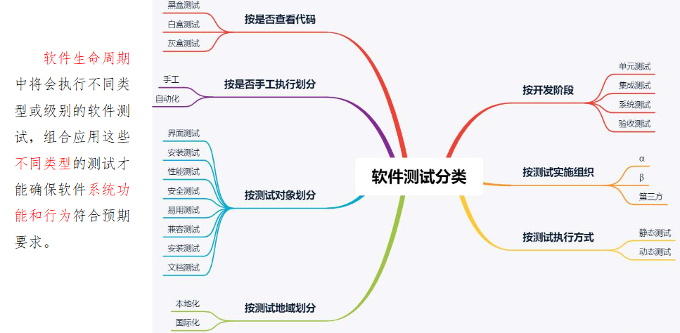

按开发阶段分类时，可以分为单元测试、继承测试、系统测试、验收测试。单元测试对应编码阶段（测试对象是单一模块或组件），集成测试对应详细设计（测试对象是一组模块或组件），系统测试和验收测试分别对应概要设计和需求阶段，对整个系统进行测试。

测试用例是指对一项指定的软件产品进行测试任务的描述，体现测试方案方法技术和策略。测试用例是为某个特殊目标而编制的一组测试输入、执行条件以及预期结果，用于核实是否满足某个特定需求。测试用例是执行的最小测试实体。

测试用例可以将测试具体量化，不同类别的软件测试用例不同。测试用例的设计方法主要有白盒测试法和黑盒测试法。白盒测试即结构测试，逻辑驱动测试或基于代码的测试，白盒法全面了解程序内部逻辑结构，对所有逻辑路径进行测试。黑盒测试即功能测试，黑盒测试着眼于程序外部结构，不考虑内部逻辑结构，主要针对软件界面和软件功能测试，无需考虑代码。

测试用例实际要遵循以下原则：正确性、全面性、连贯性、可判定性、可操作性

## 单元测试

单元测试是代码层面的测试，是对软件中最小可测试单元进行检查和验证，这个单元一般是类或者函数。单元测试是编码工作的一部分，由程序员完成，经过了单元测试的代码才是已完成代码。

通常使用JUnit，一个Java语言的单元测试框架来完成单元测试。

## 白盒测试

也称作结构测试或逻辑驱动测试，它是基于程序的源代码，已知产品的内部工作过程，主要是对程序内部结构展开测试，关注程序实现细节，检验程序中的每条通路是否都有按照预定要求正确工作。

白盒测试是函数级别的，因此需要完全了解一个函数的控制流程，可以通过绘制控制流程图的方式来建立被测对象的模型，白盒测试主要测试是对判定的测试，关注判定表达式本身的复杂度，通过对程序逻辑结构的遍历，实现测试对程序的覆盖。

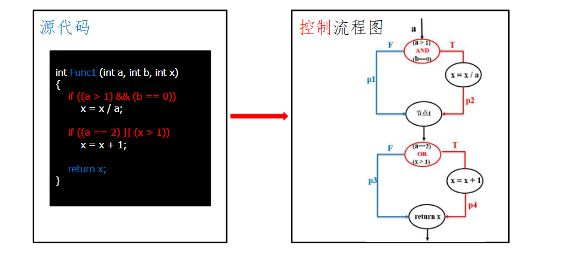

当建立好被测对象模型后，对被测对象进行测试时，需要满足一定的覆盖指标，包括：

语句覆盖（至少执行所有语句一次，最弱的逻辑覆盖）；

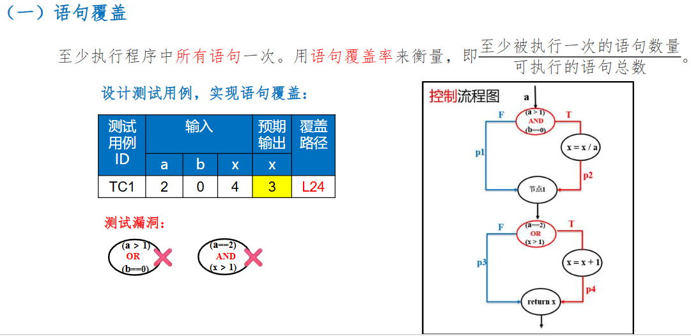

判定覆盖（至少执行程序中每个分支一次），可以看到这里在第二个判定时走的都是x>1的判定，并没有测试a==2的后续；

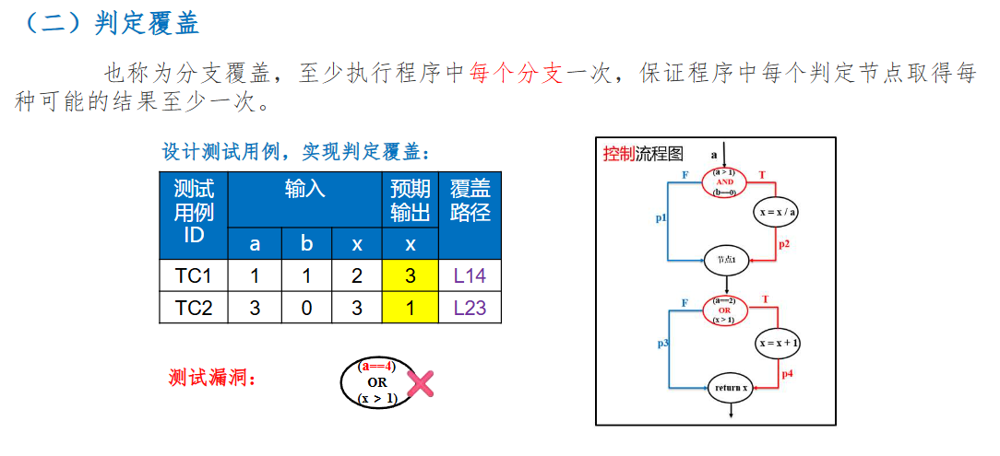

条件覆盖（保证程序中每个复合判定表达式中，每个简单判定条件的取真取假情况至少执行一次），即虽然满足了每个逻辑判断条件都取得各种可能结果，但是仍有可能走不全路径；

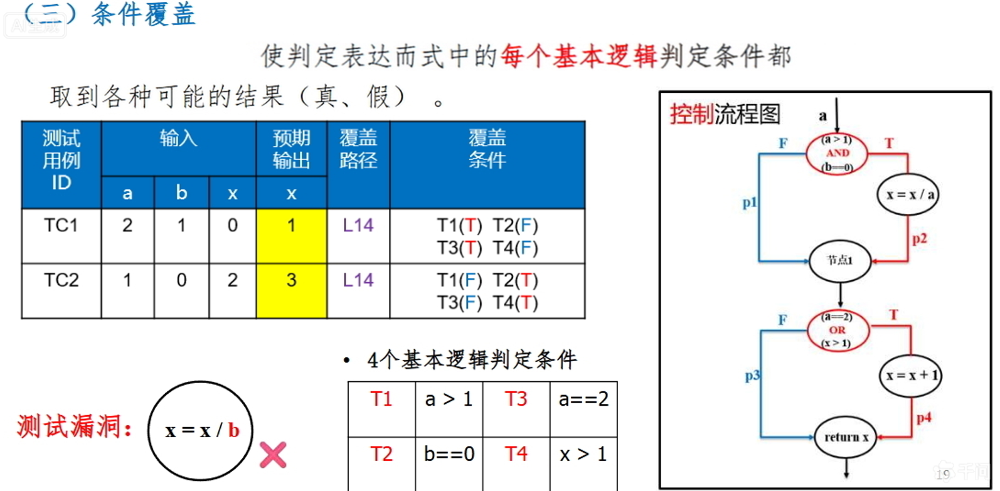

判定条件覆盖（即满足判定覆盖又满足条件覆盖）；

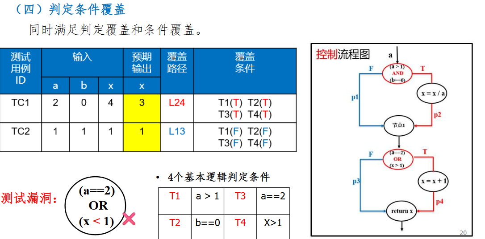

条件组合覆盖（保证程序每个判定节点中，所有简单判定条件的所有可能的取值组合情况至少执行一次）；

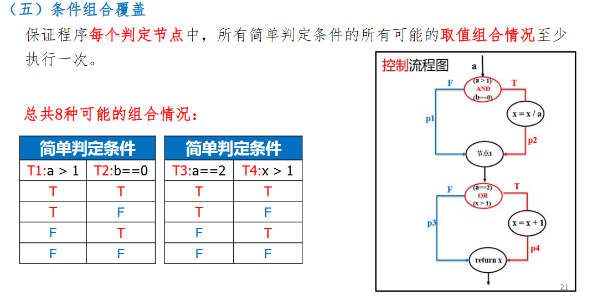

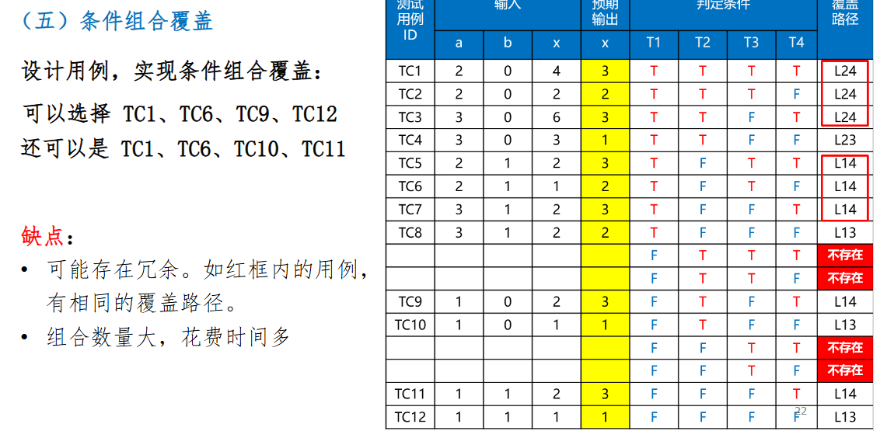

路径覆盖（使程序中每一条可能的路径至少执行一次，该策略最强的逻辑覆盖，但是一般不可实现）。

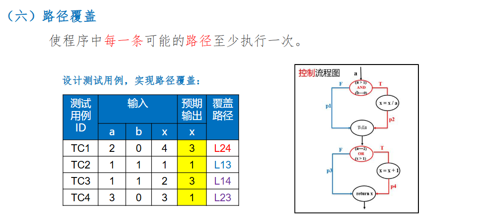

## 黑盒测试

也称作功能测试或数据驱动测试，它着眼于程序外部结构，在完全不考虑程序的内部逻辑结构和内部特性的情况下，测试者在程序接口进行测试，它只检查程序功能是否按照需求规格说明书的规定正常使用，程序是否能适当的接收输入数据而产生正确的输出信息。

### 等价类划分

等价类：输入域的一个子集，在这个子集中，各个输入数据对揭示程序中的错误是等效的。

等价类测试：将无穷多的数据缩减到有限个等价区域内，通过测试等价区域完成穷尽测试。

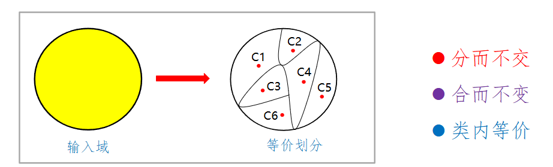

等价类在黑盒测试中一般被分为有效等价类和无效等价类，有效等价类指对于软件的规格说明书而言是合理有意义的输入数据构成的集合，用来检验系统是否能够完成指定功能；无效等价类指对于软件的规格说明书而言是不合理没有意义的输入数据构成的集合，用来检验系统的容错性。

覆盖有效等价类时需要满足所有的有效等价类，以此确保这个测试用例时有效的。而覆盖无效等价类时需要满足单一缺陷的原则，即对于每个无效等价类的测试用例，只覆盖唯一一个无效等价类，以此控制变量更好地检测是哪种无效等价类会导致出错。

### 边界值分析

这种方法倾向于选择系统边界或边界附近的数据来设计测试用例，考虑了边界条件的测试用例具有更高的测试回报率。

边界点：指等价类中那些恰好处于边界的点，这些点可能导致系统内部处理机制发生变化。

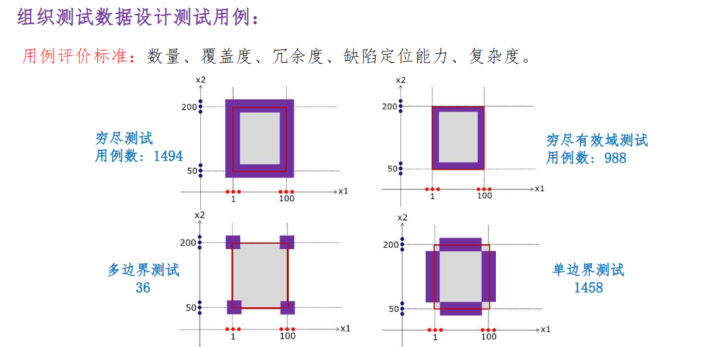

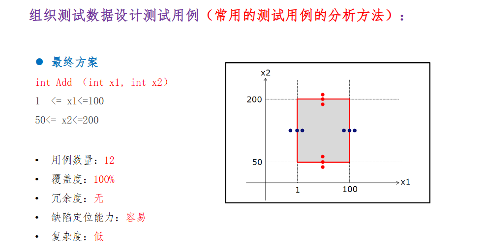

即对于每一个边界都设置边界内边界上边界外三个测试用例。

### 场景法

以事件流为核心，主要目的是测试软件的主要业务流程、主要功能的正确性和异常处理能力。

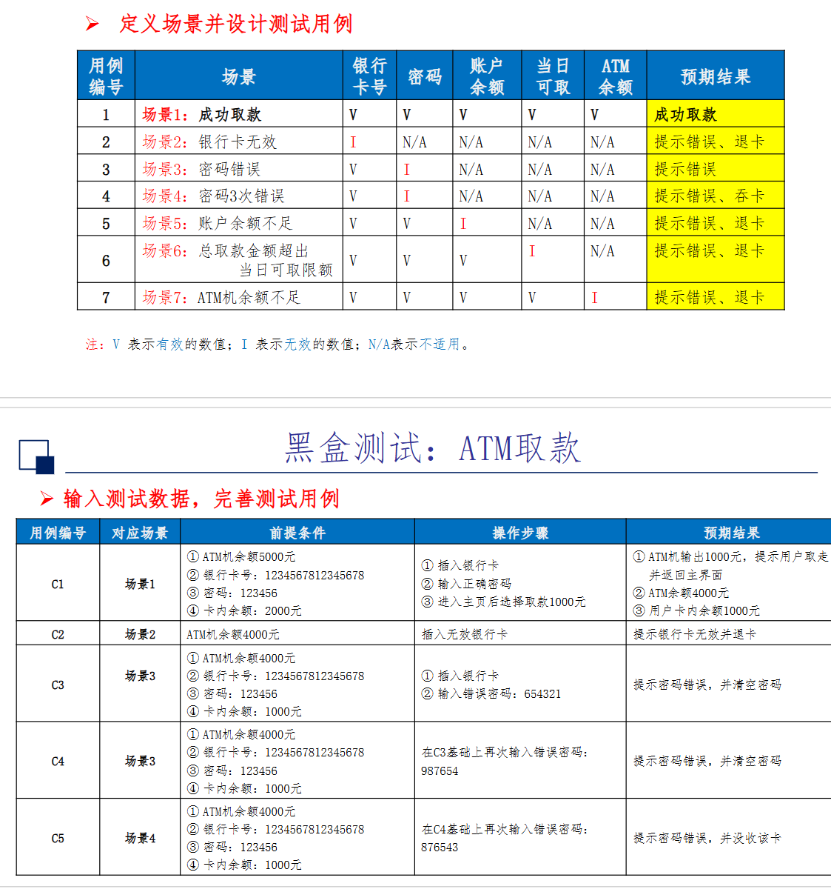

## 性能测试、代码质量

压力测试是性能测试的一种，目标是测试在一定负载下系统长时间运行的稳定性。

性能测试通常搜集所有和测试有关的所有性能，被不同人在不同场合下使用。主要测试使用时系统是否满足要求，同时为了保留系统的扩展空间进行一些超过正常范围的测试来测试稳定性。

评价代码质量可以从以下几个方面评价：可维护性、可读性、可扩展性、可复用性、可测试性、简洁性

JaCoCo：一个开源的覆盖率测试工具，方便计算覆盖率。

Gerrit：一个基于web的代码评审工具。用于在代码入库之前对每个提交进行审阅
